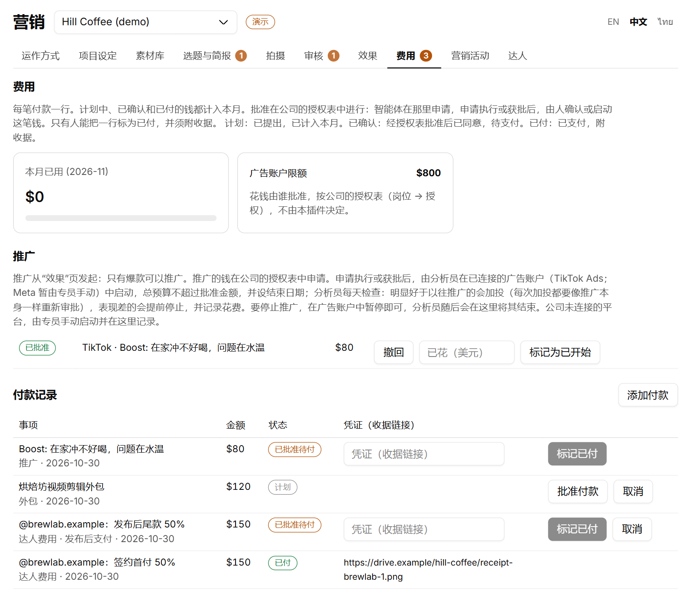

# 推广与费用

## 学习目标

学完本章，应能：

- 说明哪些内容可以推广，以及推广的钱由谁批准；
- 跟踪一个推广从申请到结束的过程；
- 在付款记录中添加、批准和标记付款。

## 费用页

页面分为三部分：本月已用金额和广告账户限额、推广、付款记录。计划中、已批准和已付的金额都计入本月。

## 花钱的两道限制

1. **广告账户限额。** 在广告平台的账户中设定，并填入项目设定的“广告账户”。超出后平台拒绝投放，无论谁批准。
2. **公司的授权表。** 每一笔花费由谁批准，按公司的授权表（岗位对应的授权）决定。营销系统只记录推广和付款，不批准任何花费。

## 只推广爆款

推广只能从“效果”页对被判为[爆款](./results.md)的内容发起。受欢迎但没有带来生意的内容不能推广，应当先更换引导动作。

### 推广的过程

| 步骤 | 由谁完成 | 说明 |
|---|---|---|
| 申请 | 负责人或分析员 | 在“效果”页对爆款点击**申请推广**，填写预算和理由 |
| 批准 | 按授权表 | 分析员在公司的授权表中提出申请；在其岗位授权范围内直接执行，超出时由有权的人批准 |
| 启动 | 分析员（智能体） | 在已连接的广告账户中建立推广：总预算不超过批准金额，并设结束日期 |
| 每日检查 | 分析员 | 记录已花金额和数字；结束到期的推广；明显差于以往推广的提前停止 |
| 结束 | 分析员 | 按实际花费更新付款记录 |

目前 TikTok 的推广由分析员直接启动；Meta 的推广暂由专员手动启动，并在费用页点击**标记为已开始**和**标记为已结束**。

需要中止一个推广时，由人在广告账户中暂停，分析员在下次检查时记录结束。尚未启动的推广可以在费用页**撤回**。

### 加投

一个推广的表现明显好于以往的推广时，分析员可以申请加投：追加预算并延长天数。每次追加不超过原预算，最多两次，并且仍须经授权表批准，不超过广告账户的月度限额。费用页显示“已申请加投”“已加投”或“加投未执行”。

### 推广达人的作品

推广达人账号上的视频需要达人的 Spark Ads 授权码：

1. 达人发布时，专员向其索取授权码。在 TikTok 中的路径是：设置 → 广告设置 → 打开广告授权 → 选择这条视频 → 授权期限选 60 天或更长 → 生成授权码。
2. 在登记视频时填写，或之后在“效果”页该内容的详情中点击**填写 Spark Ads 授权码**，同时填写授权到期日。

推广的结束日期不能晚于授权到期日。最近 30 天内缺少授权码或授权将在一周内到期的达人帖子，会出现在专员的待办中。

## 付款记录

每一笔付款占一行，类别包括达人费用、达人奖金、达人抵用金、推广、外包和工具。

| 状态 | 含义 |
|---|---|
| 计划 | 已提出，已计入本月 |
| 已批准待付 | 经授权表批准，等待支付 |
| 已付 | 已支付，并附有收据 |
| 已取消 | 不再支付 |

### 添加和处理付款

1. 点击**添加付款**，选择类别，填写用途、金额和币种。非美元金额须填写折合美元的汇率。达人费用须选择达人；可以勾选“达人视频上线后才付款”。
2. 这笔花费按公司的授权表获得批准后，负责人点击**批准付款**，状态变为“已批准待付”。
3. 专员完成支付后，在“凭证”栏填写收据链接，再点击**标记已付**。没有收据链接不能标记。

只有人可以把一行标为已付。达人合同按期付款时，每一期各占一行，例如签约时付一半、发布后付一半。

## 练习

1. 在演示项目的“费用”页，找出状态为“计划”“已批准待付”和“已付”的付款各一笔，说明每笔的下一步由谁完成。
2. 找出演示项目中已批准的推广，说明它对应哪条内容、预算是多少。
3. 说明一条看完率很高但没有带来生意的视频为什么不能申请推广。

## 本章要点

- 只有爆款可以推广；钱按公司的授权表批准。
- 推广有总预算和结束日期，分析员每天检查。
- 付款只有附上收据后才能标记为已付。
