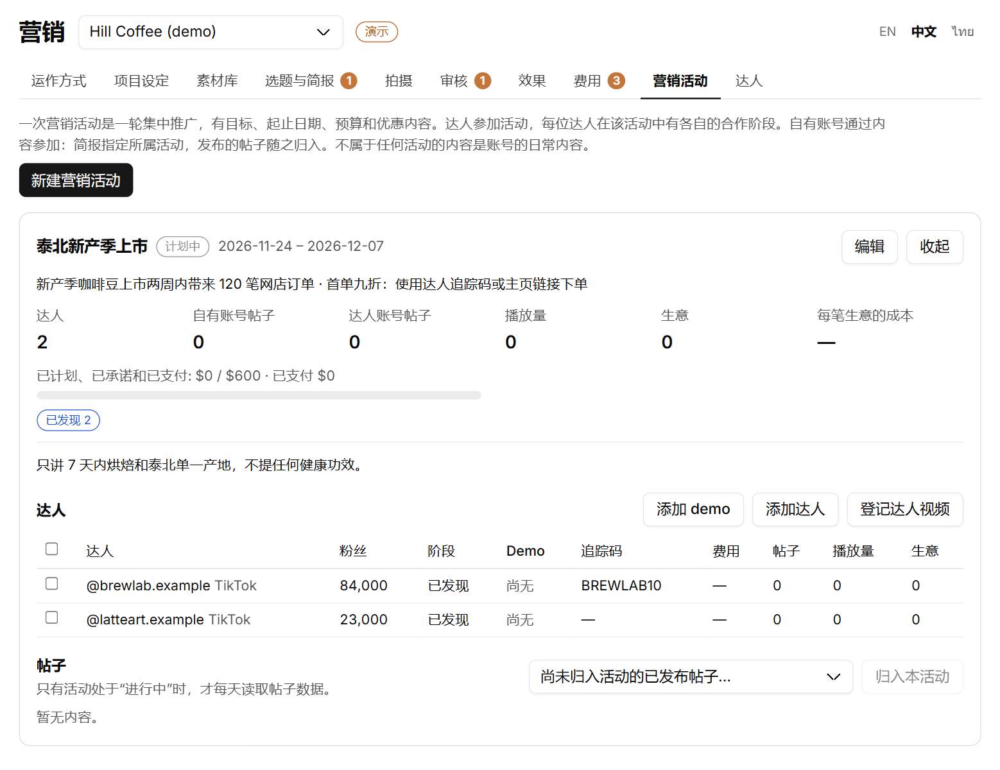

# 营销活动

## 学习目标

学完本章，应能：

- 区分账号、达人和营销活动三个概念；
- 新建一次营销活动并加入达人和内容；
- 读懂活动的汇总数字。

## 三个概念

| 概念 | 回答的问题 | 说明 |
|---|---|---|
| 账号 | 在哪里发 | 项目设定中的自有账号，有每周条数和自己的比较基准 |
| 达人 | 由谁发 | 拥有自己账号的人；其视频使用达人的追踪码 |
| 营销活动 | 为什么发 | 一轮有目标、起止日期、预算和优惠内容的集中推广 |

三者互不替代。不属于任何活动的内容是账号的日常内容。

## 活动页

每次活动显示：达人人数、自有账号帖子数、达人账号帖子数、播放量、生意数、每笔生意的成本，以及已计划、已承诺和已支付的金额相对预算的进度。

## 新建活动

1. 打开“营销活动”，点击**新建营销活动**。
2. 填写：

   | 项目 | 填写内容 |
   |---|---|
   | 名称 | 便于识别的名称 |
   | 目标 | 活动的目的和要推动的指标 |
   | 优惠内容 | 观众得到什么：优惠券、落地页、产品 |
   | 开始和结束日期 | 活动的起止 |
   | 预算 | 达人费用与付费推广的合计计划 |
   | 给所有参与者的说明 | 对智能体和成员的统一要求 |
   | 达人跟进表 | 团队用表格跟进达人时填写其链接 |

3. 保存。活动的状态为“计划中”，开始后改为“进行中”，结束后改为“已结束”。

预算是计划，不构成任何批准。每笔付款仍按公司的授权表审批。

## 达人参加活动

在活动的“达人”部分点击**添加达人**，从“达人”页的名单中选择。

合作阶段属于“某位达人在某次活动中”。同一位达人参加第二次活动时，在新活动中从“已发现”开始，与此前活动的进度无关。

填写了“达人跟进表”时，智能体可以按表格记录每个阶段：它只照录团队已经作出的决定。未填写时，智能体最多推进到“谈判中”，之后的阶段由负责人在活动页设置。

达人视频发布前的 demo 审核见[达人合作](./creators.md)。

### 登记达人的视频

达人在自己账号发布后，点击**登记达人视频**，选择达人，填写帖子链接和发布时间；有 Spark Ads 授权码时一并填写。视频使用该达人的追踪码，计入本活动，该达人的阶段随之设为“已发布”。

## 自有账号参加活动

自有账号通过内容参加活动：简报指定所属活动，由该简报制作的帖子发布后自动归入。也可以在活动页把已发布的帖子**归入本活动**，或**移出**。

归入活动的帖子仍然占用其账号的每周条数，并与该账号的基准比较。

## 活动期间的每日读取

活动处于“进行中”时，分析员每天读取一次每条帖子的公开数字，页面显示相对上一次读取的变化。活动结束后停止。

这与[效果](./results.md)中的固定时间点不同：固定时间点用于内容之间的比较，每日读取用于观察活动期间的增长。达人账号的后台数字只有达人本人可见，因此达人帖子在固定时间点的数字由相近时间的每日读取代替，不含看完率。

## 练习

1. 在演示项目的“营销活动”页打开一次活动的详情，说明它的目标、优惠内容和预算。
2. 说明该活动中每位达人所处的阶段，以及“追踪码”一栏为空意味着什么。
3. 为你的项目设计一次两周的活动：写出目标、优惠内容，以及自有账号和达人各自承担的部分。

## 本章要点

- 活动说明“为什么发”，与账号和达人是三个不同的概念。
- 达人的合作阶段按活动分别记录。
- 活动的预算是计划，付款仍须按授权表批准。
