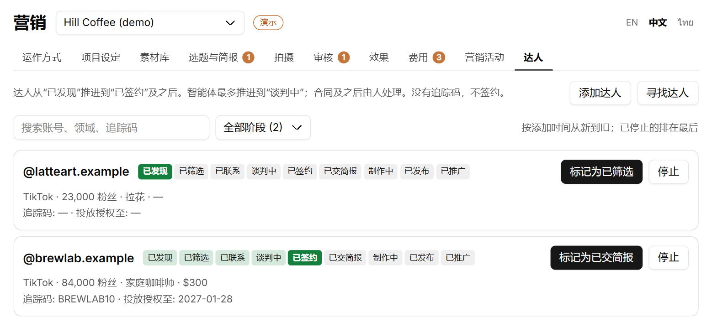

# 达人合作

## 学习目标

学完本章，应能：

- 说明达人合作的各个阶段，以及智能体和人各自负责的范围；
- 发起一次达人寻找，并读懂达人的评估信息；
- 说明追踪码和发布前审核在合作中的作用。

## 达人页

每位达人显示平台、粉丝数、领域、报价、追踪码和投放授权的到期日。上方可以按阶段筛选，并搜索账号、领域或追踪码。

## 合作阶段

| 阶段 | 含义 | 由谁推进 |
|---|---|---|
| 已发现 | 进入名单 | 智能体或人 |
| 已筛选 | 已按近期作品评估，符合条件 | 智能体或人 |
| 已联系 | 已发出合作邀请 | 人联系；智能体可以记录 |
| 谈判中 | 正在商谈条件 | 人商谈；智能体可以记录 |
| 已签约 | 合同已签 | 只能由人设置 |
| 已交简报 | 已向达人说明内容要求 | 人 |
| 制作中 | 达人正在制作 | 人 |
| 已发布 | 视频已在达人账号发布 | 登记视频时自动设置 |
| 已推广 | 视频已付费推广 | 人 |
| 已停止 | 不再合作 | 人 |

智能体最多把达人推进到“谈判中”。合同及之后的阶段涉及承诺和付款，由人处理。智能体不联系达人，所有对外沟通由人完成。

## 寻找达人

达人发掘智能体每周按项目设定中的“达人计划”寻找一次。需要立即寻找时：

1. 在“达人”页点击**寻找达人**。
2. 勾选达人计划中的条目，可以在“重点”中补充要求，例如一类达人、要避开的竞品代言人、一个城市。
3. 点击**发给达人发掘智能体**。

智能体依据每位达人最近的作品评估，并把合适的达人加入名单：

| 评估项 | 含义 |
|---|---|
| 播放中位数 | 最近约 20 条作品的常规播放量，比粉丝数更能反映实际触达 |
| 互动率 | 点赞、评论和转发相对播放量的比例 |
| 发布频率和最近发布时间 | 账号是否活跃 |
| 作品 | 两三条能说明其适合本项目的作品，附播放量和说明 |
| 适合原因 | 受众、话题、风格，以及可能的风险 |

也可以点击**添加达人**手动加入。

## 追踪码

每位达人有自己的追踪码，买家下单或注册时填写，生意由此归属到该达人。**没有追踪码的达人不能签约。** 在达人卡片上填写并**保存追踪码**后，才能设置为“已签约”。

## 合同与付款

签约由负责人决定。合同中应当包括：交付的视频数量、费用和付款节点、追踪码的使用、内容用于付费推广的授权及其期限。

费用在“费用”页按付款节点逐笔记录，并按公司的授权表批准，见[推广与费用](./boosts.md)。

## 发布前审核

达人参加[营销活动](./campaigns.md)时，视频发布前须把样片（demo）发给团队：

1. 在活动的达人列表中点击**添加 demo**，填写共享文件链接。
2. 素材审核智能体对照活动说明和项目规则检查，用中文报告。需要修改时附有“转给达人的话”，以达人的语言写成并附中文，由专员转发。
3. 审核人**批准 demo**或**退回**。审核人可以不等报告直接决定。
4. 只有 demo 获批准后，达人的视频才能登记为已发布。

视频发布并登记后，素材审核智能体把已发布的视频与批准的 demo 核对。不一致时，负责人收到任务。

对于开始使用此流程之前已经发布的视频，或未提交 demo 就发布的视频，负责人可以**无 demo 放行**，并须填写原因。

## 练习

1. 在演示项目的“达人”页，说明两位达人各处于哪个阶段，下一步由谁推进。
2. 找出已有追踪码的达人，说明追踪码的用途。
3. 列出与达人签约前必须确认的四项内容。

## 本章要点

- 智能体负责寻找和评估，联系、谈判、签约和付款由人完成。
- 没有追踪码不签约。
- 活动中的达人视频须在发布前通过 demo 审核。
