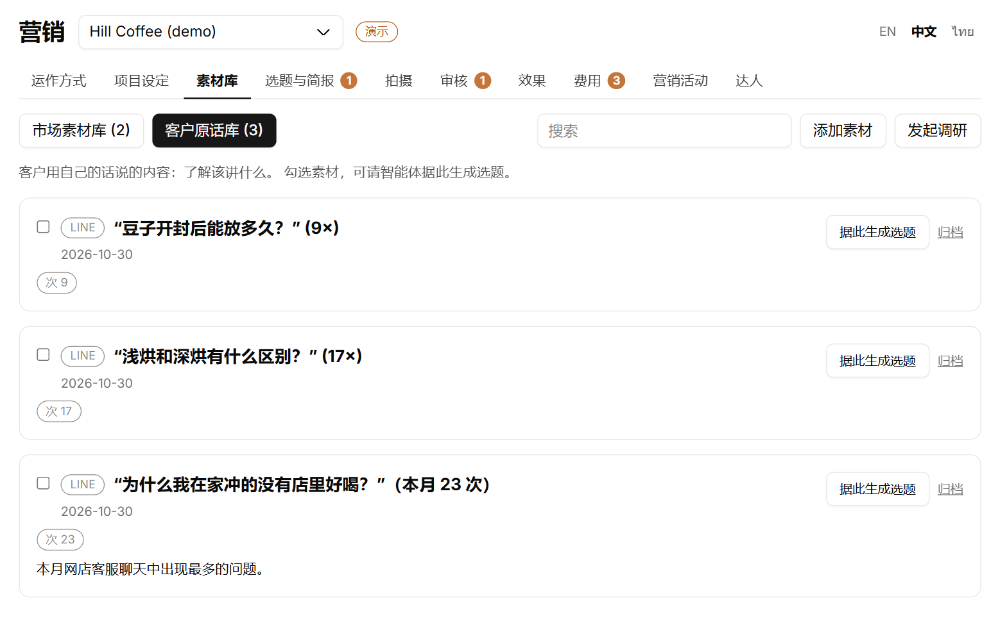
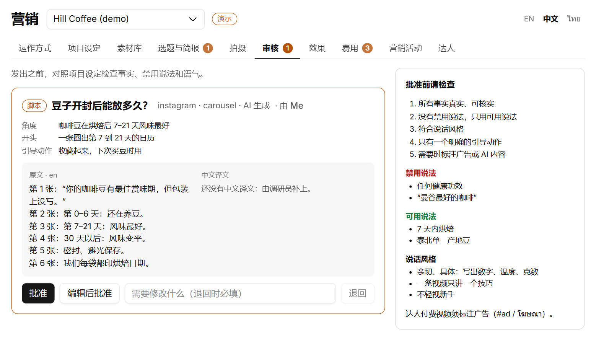

# 快速上手：一条内容的全过程

## 学习目标

学完本章，应能：

- 登录系统并找到自己的待办事项；
- 说出一条内容从客户的一个问题到获得推广所经过的每一步；
- 指出每一步由谁完成、在哪个页面完成。

本章用演示项目 Hill Coffee 中一条已经走完全程的内容作为例子。Hill Coffee 是一家虚构的咖啡烘焙坊，通过网店销售咖啡豆；例子中的数字和记录都可以在演示项目中看到，人物的做法是为说明流程而写的。后面各章分别详细说明每一步。

## 第一次登录

1. 登录公司的智能体工作平台，在左侧菜单选择“营销”。
2. 在页面顶部的下拉框中选择项目。本章请选择 **Hill Coffee (demo)**。
3. 页面右上角选择“中文”。
4. 查看“运作方式”页顶部的“等你处理”：这里列出需要你本人处理的事项。

以后每天的工作都从“等你处理”开始。

## 例子：《在家冲不好喝，问题在水温》

这条视频从客户反复提出的一个问题开始，经过十个步骤，最后成为项目的一条爆款并获得推广。下表是全过程的概览，之后逐步说明。

| 步骤 | 发生了什么 | 由谁完成 | 页面 |
|---|---|---|---|
| 1 | 客户的问题进入客户原话库 | 专员 | 素材库 |
| 2 | 一条同行视频进入市场素材库并被分析 | 调研员（智能体） | 素材库 |
| 3 | 提出选题 | 内容制作（智能体） | 选题与简报 |
| 4 | 选定选题 | 负责人 | 选题与简报 |
| 5 | 撰写并确认简报 | 内容制作撰写，负责人确认 | 选题与简报 |
| 6 | 撰写并审核脚本 | 内容制作撰写，审核人审核 | 审核 |
| 7 | 拍摄、上传素材、剪辑、审核成品 | 专员、素材审核和视频剪辑（智能体）、审核人 | 选题与简报、审核 |
| 8 | 发布并登记 | 专员 | 选题与简报 |
| 9 | 记录数字，判定为爆款 | 分析员（智能体）、专员 | 效果 |
| 10 | 申请、批准并启动推广 | 负责人、分析员；按授权表批准 | 效果、费用 |

### 步骤 1：客户的问题

客服在聊天中反复被问到同一个问题：“为什么我在家冲的没有店里好喝？”本月出现了 23 次。专员把它加入客户原话库。

客户原话决定**讲什么**。出现次数多的问题，说明有很多人关心。

### 步骤 2：一条值得学习的同行视频

调研员在每周调研中找到一条同行视频《手冲咖啡最常见的三个错误》，播放量 41.2 万，明显高于该账号平时的水平。调研员把它加入市场素材库并分析：

- 开头：“你的咖啡发酸，不是豆子的问题。”
- 为什么有效（推断）：开头直接说出观众的困扰并推翻他们的猜测；每个错误都能马上照做。
- 可借鉴之处：借鉴“推翻猜测”式的开头，不照搬对方的三个错误。

市场素材决定**怎么讲**。

### 步骤 3：提出选题

内容制作智能体把两者结合：用同行视频的开头形式，回答客户的问题。它提出选题《在家冲不好喝，问题在水温》，归入内容主题“冲煮知识”，并注明要验证的假设：“推翻猜测”式开头比提问式开头效果好。

选题出现在“选题与简报”页的“等负责人决定”一列。

### 步骤 4：负责人选定

负责人看到这个选题对应客户最常问的问题，属于占比尚未用完的内容主题，团队本周也有拍摄名额，于是点击**选定**。

### 步骤 5：简报

选定后，内容制作智能体撰写简报。负责人阅读后点击**确认简报**。

| 简报项 | 内容 |
|---|---|
| 制作方式 | 实拍 + AI 剪辑 |
| 平台 | tiktok |
| 形式 | 口播技巧 |
| 角度 | 不好喝不是豆子的错，调对水温立刻改善 |
| 开头 | 推翻猜测：“你在家冲的咖啡发苦，不是豆子不好。” |
| 时长 | 30–40 秒 |
| 引导动作 | 评论区领水温表 |
| 引导到哪里 | 网店链接，带有这条内容专用的追踪参数 |

简报在动笔之前确定了这条内容的全部要点。注意引导动作只有一个，并且指向一个可以追踪的位置。

### 步骤 6：脚本和审核

简报确认后，内容制作智能体撰写脚本并提交审核。审核人在“审核”页对照右侧的检查项和项目规则逐条检查：事实是否可以核实，是否使用了禁用说法，是否符合说话风格，引导动作是否只有一个。

这份脚本共提交两版，第二版获得批准。批准的脚本只有三句：

1. 抓注意力（0–2 秒）：“你在家冲的咖啡发苦，不是豆子不好。”（画面：倒掉一杯）
2. 留住：“同一种豆子，100 度和 92 度各冲一杯。”（并排对比）
3. 给回报：“浅烘用 92–94 度，深烘用 86–88 度。完整水温表在评论区。”

上图是“审核”页当前的样子，显示的是另一份待审核的脚本。

### 步骤 7：拍摄、剪辑和成品

脚本批准后，专员收到制作任务，按脚本拍摄，然后在选题详情的“原始素材”中上传片段并提交。之后的过程是：

- 素材审核智能体把素材中说的话与脚本逐句对照，确认没有缺少或说错的句子；
- 审核通过后，视频剪辑智能体剪出成品，并附上剪辑说明；
- 成品进入“审核”页，由审核人批准。

选题详情把这条内容的全部材料放在一处：依据的素材、简报、脚本、成品和原始素材。

### 步骤 8：发布并登记

专员在 TikTok 发布成品，评论区放上带追踪参数的网店链接。然后在选题详情中点击**记录为已发布**，填写帖子链接、追踪链接和发布时间。这条视频于 2026-10-26 发布。

登记之后，效果统计才开始。

### 步骤 9：数字和判定

发布后，系统在固定的时间点记录数字。这条视频在 72 小时的数字是：

| 曝光 | 3 秒留存 | 看完率 | 收藏 | 转发 | 评论 | 点击 |
|---|---|---|---|---|---|---|
| 18,200 | 75.0% | 48.0% | 720 | 445 | 188 | 14 |

系统只把它与本账号最近 20 条同类视频比较：看完率好于其中的 100%，“收藏 + 转发”好于 95%。同时，这条视频记录到 3 次生意。

两项互动数字都在前 10%，并且带来了生意，因此判定为**爆款**。

同一时期的另一条视频《10 秒学会拉花》互动数字同样靠前，但没有带来生意，判定为“受欢迎但没成交”。它不能推广，应当先更换引导动作。

### 步骤 10：推广

爆款可以申请推广。负责人在“效果”页为这条视频申请 80 美元的推广预算，这笔钱按公司的授权表获得批准。批准之后，由分析员在广告账户中启动并每天检查。在演示项目中，这笔推广处于“已批准”、尚未启动的状态，“费用”页显示它及其付款记录。

### 复盘

这条视频连同它的数字回到市场素材库。它验证了简报中的假设：“推翻猜测”式的开头有效。分析员据此提出对项目设定中“待验证的假设”的修改建议，由老板批准。下一周的选题会更多地使用这种开头。

## 从例子中得到的要点

1. **话题来自客户，形式来自市场。** 步骤 1 和步骤 2 缺一不可。
2. **每一步有明确的负责者。** 智能体提出、撰写、检查和统计；人选定、确认、审核、发布和批准花钱。
3. **简报先于制作。** 角度、开头和引导动作在动笔之前就已确定。
4. **追踪决定能否判定。** 没有步骤 8 的追踪链接，就没有步骤 9 的 3 次生意，这条视频只能算“受欢迎但没成交”。
5. **只为已证明有效的内容花钱。** 推广发生在判定之后。

## 练习

1. 在演示项目中按本章的十个步骤，依次打开对应的页面，找到本章提到的每一项信息：客户的问题、同行视频的分析、选题、简报、脚本、发布日期、72 小时的数字、判定和推广。
2. 在“选题与简报”页找到选题《豆子开封后能放多久？》，说明它目前处于十个步骤中的哪一步，下一步由谁完成。
3. 对照本章的例子，说明你的角色参与其中的哪几步。

## 本章要点

- 一条内容经过十个步骤，从客户的一个问题到获得推广。
- 每天的工作从“等你处理”开始。
- 后面各章按这十个步骤的顺序展开。
