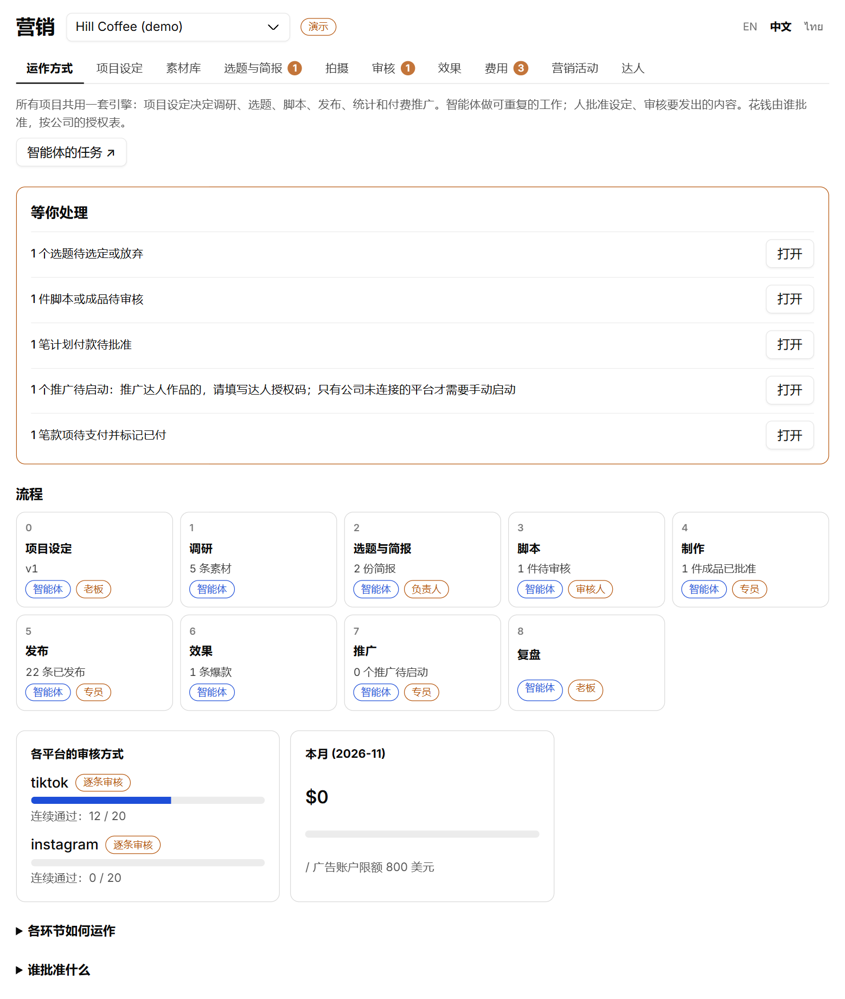
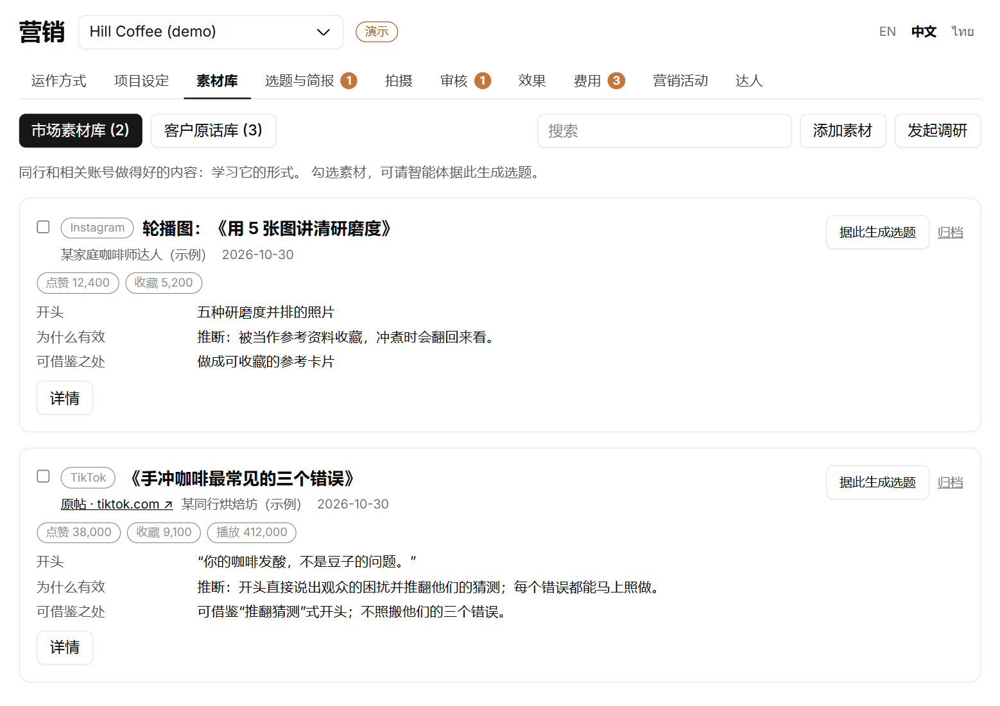
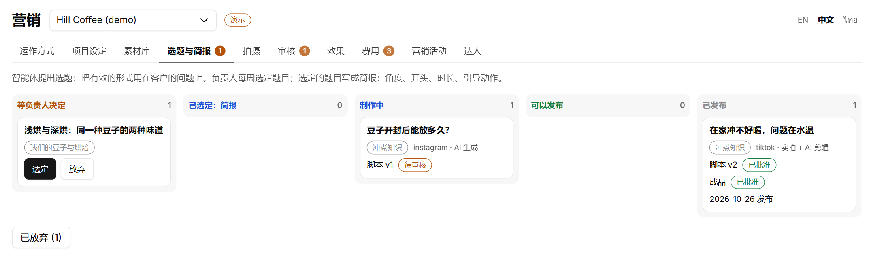
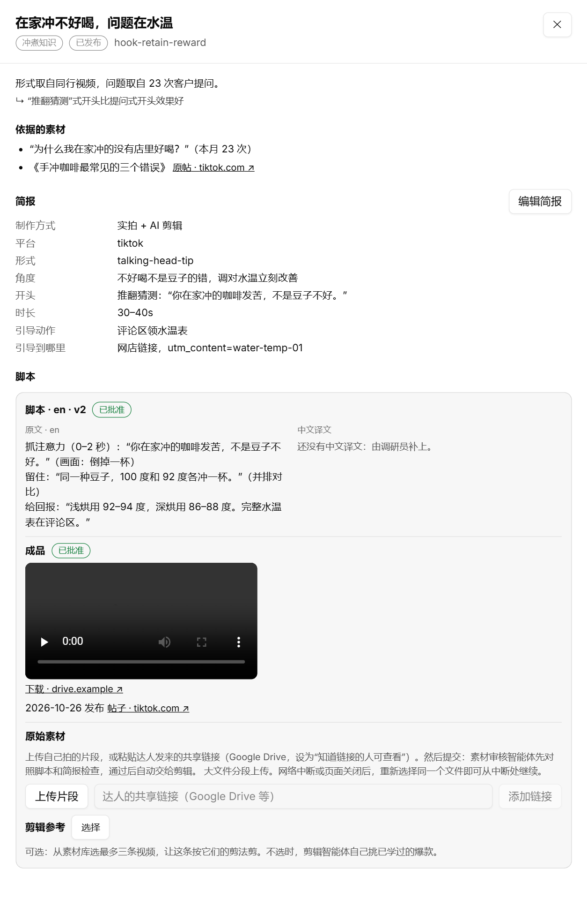
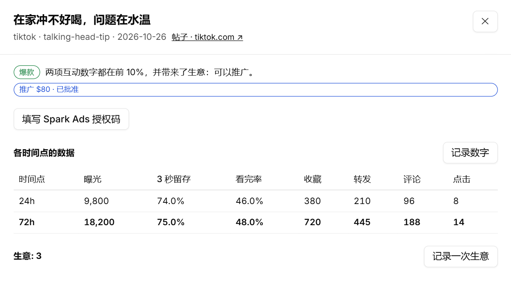
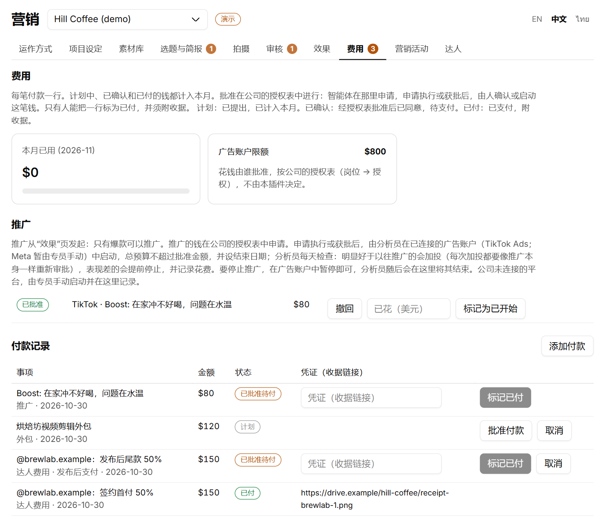

# 快速上手：从项目到每一项工作

## 学习目标

学完本章，应能：

- 说明项目是什么，以及一个项目之下系统管理哪些内容；
- 对每一类内容，说出它在哪个页面、由谁负责；
- 用一条内容的全过程，把这些内容连起来。

本章自上而下：先讲项目，再讲项目之下的六个部分和其中的每一类内容，最后用演示项目中的一条视频走完全程。后面各章分别详细说明。

## 项目

**项目**是营销的管理单位：为一个品牌在一个市场做营销。例如同一家公司在泰国和越南各做一套营销，就是两个项目。

系统中的一切都属于某个项目。项目之间互不影响：各有各的设定、素材、选题、内容、数字和费用。所有项目使用同一套流程，差别只在各自的项目设定。

### 进入一个项目

1. 登录公司的智能体工作平台，在左侧菜单选择“营销”。
2. 页面顶部的下拉框列出公司的全部项目，选择其中一个。本章请选择演示项目 **Hill Coffee (demo)**。
3. 页面右上角选择“中文”。

### 为项目启用营销

项目在平台的项目列表中创建。尚未启用营销的项目，在下拉框中标有“未启用营销”。选择它之后，由公司的所有者或管理员点击**为此项目启用营销**。

启用之后，项目有了自己的设定、素材库、选题、审核、效果和费用记录，但还不会运行：**项目设定获得老板批准之前，智能体不做任何工作。**

项目不再做营销时，由所有者在“项目设定”页底部**停用营销**。停用不删除任何数据。

## 项目之下的六个部分

| 部分 | 其中的内容 | 主要负责者 |
|---|---|---|
| 基础 | 项目设定、人员、智能体 | 老板、所有者 |
| 内容 | 素材库、选题与简报、脚本、原始素材与拍摄、成品 | 负责人、审核人、专员 |
| 发布与效果 | 帖子与追踪、数字与生意、判定 | 专员 |
| 花费 | 推广、付款记录、广告账户限额 | 负责人、专员 |
| 合作 | 达人、营销活动、达人的 demo、Spark Ads 授权码 | 负责人、审核人、专员 |
| 协作 | 待办事项、智能体的任务、审核方式 | 所有人 |

以下按这张表逐个部分说明：每个部分管理什么、在哪个页面、由谁负责。

### 基础

基础部分决定项目如何运行。它们都在“项目设定”页，由老板和所有者负责。

| 内容 | 系统管理什么 | 由谁负责 | 详见 |
|---|---|---|---|
| 项目设定 | 目标、客户、定位、内容主题、说话风格、语言、术语表、发布平台、引导到哪里、素材来源、调研计划、达人计划、能力、规则、广告账户、爆款规则、待验证的假设；每次修改保存为一个版本 | 起草后由老板批准 | [项目设定](./settings.md) |
| 人员 | 谁是负责人、审核人、专员；每种发布语言的检查人 | 老板批准 | [整体流程](./overview.md) |
| 智能体 | 六项工作各由哪个智能体承担：调研员、内容制作、分析员、达人发掘、素材审核、视频剪辑 | 所有者设置 | [整体流程](./overview.md) |

三点需要记住：

- 智能体只依据已批准的项目设定工作，缺少的内容不得自行猜测。
- 人员必须是人。批准、审核、签约和付款不能交给智能体。
- 某项工作没有指定智能体时，这项工作由人完成，页面上会给出提示。

### 内容

内容部分是每周的主要工作。一条内容大致依次经过下表中的各项。

| 内容 | 系统管理什么 | 由谁负责 | 页面 | 详见 |
|---|---|---|---|---|
| 市场素材库 | 同行做得好的内容，每条附数字和分析 | 调研员搜集；成员可以添加 | 素材库 | [调研与素材库](./research.md) |
| 客户原话库 | 客户用自己的话说的问题和顾虑 | 调研员整理；成员可以添加 | 素材库 | [调研与素材库](./research.md) |
| 选题 | 题目、所属内容主题、依据的素材、要验证的假设 | 内容制作提出；负责人选定或放弃 | 选题与简报 | [选题与简报](./ideas.md) |
| 简报 | 制作方式、平台、形式、角度、开头、时长、引导动作、引导到哪里、所属活动 | 内容制作撰写；负责人确认 | 选题与简报 | [选题与简报](./ideas.md) |
| 脚本 | 发布语言的完整文字及其中文回译，按版本保存 | 内容制作撰写；语言检查人检查；审核人批准或退回 | 审核 | [脚本与审核](./review.md) |
| 原始素材 | 为一条脚本上传的片段或达人的共享链接；素材审核报告 | 专员上传；素材审核检查 | 选题与简报 | [制作方式与原始素材](./production.md) |
| 拍摄 | 为多条脚本集中拍摄的一天：脚本清单、全部片段、每个片段的类别和所属脚本、缺少的句子 | 专员新建和上传；素材审核整理 | 拍摄 | [集中拍摄](./shoots.md) |
| 成品 | 可以发布的最终内容；视频附剪辑说明 | 视频剪辑或内容制作提交；审核人批准或退回 | 审核 | [剪辑与成品](./editing.md) |

“选题与简报”页的看板显示每个选题走到了哪一步；点击一个选题，可以看到它的简报、脚本、原始素材和成品。

### 发布与效果

| 内容 | 系统管理什么 | 由谁负责 | 页面 | 详见 |
|---|---|---|---|---|
| 帖子 | 已发布内容的链接、发布时间、所在账号 | 专员发布并登记 | 选题与简报 | [发布与追踪](./publishing.md) |
| 追踪 | 每条内容的追踪链接或追踪码 | 专员在发布时使用并登记 | 选题与简报 | [发布与追踪](./publishing.md) |
| 数字 | 发布后 1 小时、24 小时、72 小时、7 天、28 天的曝光、留存、看完率、收藏、转发、评论、点击 | 分析员读取公开数字；专员补充后台数字 | 效果 | [效果与爆款判定](./results.md) |
| 生意 | 由内容带来的咨询、注册和订单 | 按追踪记录；专员补记 | 效果 | [发布与追踪](./publishing.md) |
| 判定 | 每条内容是爆款、受欢迎但没成交，还是普通 | 系统按项目的爆款规则判定 | 效果 | [效果与爆款判定](./results.md) |

### 花费

| 内容 | 系统管理什么 | 由谁负责 | 页面 | 详见 |
|---|---|---|---|---|
| 推广 | 为爆款申请的预算、状态、已花金额、每日检查的结果、加投 | 负责人或分析员申请；按公司授权表批准；分析员启动和检查 | 效果、费用 | [推广与费用](./boosts.md) |
| 付款记录 | 每一笔付款：类别、金额、状态、收据 | 负责人批准付款；专员支付并标记已付 | 费用 | [推广与费用](./boosts.md) |
| 广告账户限额 | 本月已用金额与限额的对比 | 老板在项目设定中填写 | 运作方式、费用 | [推广与费用](./boosts.md) |

系统只记录花费，不批准花费。每一笔钱由谁批准，按公司的授权表。

### 合作

| 内容 | 系统管理什么 | 由谁负责 | 页面 | 详见 |
|---|---|---|---|---|
| 达人 | 账号、粉丝、领域、评估数字、报价、追踪码、合作阶段 | 达人发掘寻找和评估；人联系、谈判和签约 | 达人 | [达人合作](./creators.md) |
| 营销活动 | 目标、优惠内容、起止日期、预算；参加的达人及其阶段；归入的帖子；汇总数字 | 负责人新建和管理 | 营销活动 | [营销活动](./campaigns.md) |
| 达人的 demo | 达人发布前发来的视频、审核报告、审核意见 | 素材审核检查；审核人批准或退回 | 营销活动 | [达人合作](./creators.md) |
| Spark Ads 授权码 | 推广达人视频所需的授权码及其到期日 | 专员向达人索取并填写 | 效果、营销活动 | [推广与费用](./boosts.md) |

### 协作

| 内容 | 系统管理什么 | 页面 | 详见 |
|---|---|---|---|
| 待办事项 | 按你的角色列出需要你本人处理的事项 | 运作方式 | [页面与日常入口](./workspace.md) |
| 智能体的任务 | 智能体的每项工作及其进度；可以在任务中留言或回答提问 | 运作方式右上角 | [页面与日常入口](./workspace.md) |
| 审核方式 | 每个平台是逐条审核还是抽查，以及连续通过的件数 | 运作方式 | [整体流程](./overview.md) |

每天的工作从“等你处理”开始。

## 把各部分连起来

上面六个部分是系统管理的全部内容。下面用一条内容说明它们如何前后相接。

### 例子：《在家冲不好喝，问题在水温》

这条视频从客户反复提出的一个问题开始，经过十个步骤，最后成为项目的一条爆款并获得推广。下表是全过程的概览，之后逐步说明。

| 步骤 | 发生了什么 | 由谁完成 | 页面 |
|---|---|---|---|
| 1 | 客户的问题进入客户原话库 | 专员 | 素材库 |
| 2 | 一条同行视频进入市场素材库并被分析 | 调研员（智能体） | 素材库 |
| 3 | 提出选题 | 内容制作（智能体） | 选题与简报 |
| 4 | 选定选题 | 负责人 | 选题与简报 |
| 5 | 撰写并确认简报 | 内容制作撰写，负责人确认 | 选题与简报 |
| 6 | 撰写并审核脚本 | 内容制作撰写，审核人审核 | 审核 |
| 7 | 拍摄、上传素材、剪辑、审核成品 | 专员、素材审核和视频剪辑（智能体）、审核人 | 选题与简报、审核 |
| 8 | 发布并登记 | 专员 | 选题与简报 |
| 9 | 记录数字，判定为爆款 | 分析员（智能体）、专员 | 效果 |
| 10 | 申请、批准并启动推广 | 负责人、分析员；按授权表批准 | 效果、费用 |

#### 步骤 1：客户的问题

客服在聊天中反复被问到同一个问题：“为什么我在家冲的没有店里好喝？”本月出现了 23 次。专员把它加入客户原话库。

客户原话决定**讲什么**。出现次数多的问题，说明有很多人关心。

#### 步骤 2：一条值得学习的同行视频

调研员在每周调研中找到一条同行视频《手冲咖啡最常见的三个错误》，播放量 41.2 万，明显高于该账号平时的水平。调研员把它加入市场素材库并分析：

- 开头：“你的咖啡发酸，不是豆子的问题。”
- 为什么有效（推断）：开头直接说出观众的困扰并推翻他们的猜测；每个错误都能马上照做。
- 可借鉴之处：借鉴“推翻猜测”式的开头，不照搬对方的三个错误。

市场素材决定**怎么讲**。

#### 步骤 3：提出选题

内容制作智能体把两者结合：用同行视频的开头形式，回答客户的问题。它提出选题《在家冲不好喝，问题在水温》，归入内容主题“冲煮知识”，并注明要验证的假设：“推翻猜测”式开头比提问式开头效果好。

选题出现在“选题与简报”页的“等负责人决定”一列。

#### 步骤 4：负责人选定

负责人看到这个选题对应客户最常问的问题，属于占比尚未用完的内容主题，团队本周也有拍摄名额，于是点击**选定**。

#### 步骤 5：简报

选定后，内容制作智能体撰写简报。负责人阅读后点击**确认简报**。

| 简报项 | 内容 |
|---|---|
| 制作方式 | 实拍 + AI 剪辑 |
| 平台 | tiktok |
| 形式 | 口播技巧 |
| 角度 | 不好喝不是豆子的错，调对水温立刻改善 |
| 开头 | 推翻猜测：“你在家冲的咖啡发苦，不是豆子不好。” |
| 时长 | 30–40 秒 |
| 引导动作 | 评论区领水温表 |
| 引导到哪里 | 网店链接，带有这条内容专用的追踪参数 |

简报在动笔之前确定了这条内容的全部要点。注意引导动作只有一个，并且指向一个可以追踪的位置。

#### 步骤 6：脚本和审核

简报确认后，内容制作智能体撰写脚本并提交审核。审核人在“审核”页对照右侧的检查项和项目规则逐条检查：事实是否可以核实，是否使用了禁用说法，是否符合说话风格，引导动作是否只有一个。

这份脚本共提交两版，第二版获得批准。批准的脚本只有三句：

1. 抓注意力（0–2 秒）：“你在家冲的咖啡发苦，不是豆子不好。”（画面：倒掉一杯）
2. 留住：“同一种豆子，100 度和 92 度各冲一杯。”（并排对比）
3. 给回报：“浅烘用 92–94 度，深烘用 86–88 度。完整水温表在评论区。”

上图是“审核”页当前的样子，显示的是另一份待审核的脚本。

#### 步骤 7：拍摄、剪辑和成品

脚本批准后，专员收到制作任务，按脚本拍摄，然后在选题详情的“原始素材”中上传片段并提交。之后的过程是：

- 素材审核智能体把素材中说的话与脚本逐句对照，确认没有缺少或说错的句子；
- 审核通过后，视频剪辑智能体剪出成品，并附上剪辑说明；
- 成品进入“审核”页，由审核人批准。

选题详情把这条内容的全部材料放在一处：依据的素材、简报、脚本、成品和原始素材。

#### 步骤 8：发布并登记

专员在 TikTok 发布成品，评论区放上带追踪参数的网店链接。然后在选题详情中点击**记录为已发布**，填写帖子链接、追踪链接和发布时间。这条视频于 2026-10-26 发布。

登记之后，效果统计才开始。

#### 步骤 9：数字和判定

发布后，系统在固定的时间点记录数字。这条视频在 72 小时的数字是：

| 曝光 | 3 秒留存 | 看完率 | 收藏 | 转发 | 评论 | 点击 |
|---|---|---|---|---|---|---|
| 18,200 | 75.0% | 48.0% | 720 | 445 | 188 | 14 |

系统只把它与本账号最近 20 条同类视频比较：看完率好于其中的 100%，“收藏 + 转发”好于 95%。同时，这条视频记录到 3 次生意。

两项互动数字都在前 10%，并且带来了生意，因此判定为**爆款**。

同一时期的另一条视频《10 秒学会拉花》互动数字同样靠前，但没有带来生意，判定为“受欢迎但没成交”。它不能推广，应当先更换引导动作。

#### 步骤 10：推广

爆款可以申请推广。负责人在“效果”页为这条视频申请 80 美元的推广预算，这笔钱按公司的授权表获得批准。批准之后，由分析员在广告账户中启动并每天检查。在演示项目中，这笔推广处于“已批准”、尚未启动的状态，“费用”页显示它及其付款记录。

#### 复盘

这条视频连同它的数字回到市场素材库。它验证了简报中的假设：“推翻猜测”式的开头有效。分析员据此提出对项目设定中“待验证的假设”的修改建议，由老板批准。下一周的选题会更多地使用这种开头。

## 从例子中得到的要点

1. **话题来自客户，形式来自市场。** 步骤 1 和步骤 2 缺一不可。
2. **每一步有明确的负责者。** 智能体提出、撰写、检查和统计；人选定、确认、审核、发布和批准花钱。
3. **简报先于制作。** 角度、开头和引导动作在动笔之前就已确定。
4. **追踪决定能否判定。** 没有步骤 8 的追踪链接，就没有步骤 9 的 3 次生意，这条视频只能算“受欢迎但没成交”。
5. **只为已证明有效的内容花钱。** 推广发生在判定之后。

## 练习

1. 对照“项目之下的六个部分”的表，在演示项目中为表中的每一项找到对应的页面。
2. 在演示项目中按本章的十个步骤，依次打开对应的页面，找到本章提到的每一项信息：客户的问题、同行视频的分析、选题、简报、脚本、发布日期、72 小时的数字、判定和推广。
3. 在“选题与简报”页找到选题《豆子开封后能放多久？》，说明它目前处于十个步骤中的哪一步，下一步由谁完成。
4. 对照本章的例子，说明你的角色参与其中的哪几步。

## 本章要点

- 项目是管理单位；项目之下分为基础、内容、发布与效果、花费、合作和协作六个部分。
- 每一类内容都有固定的页面和负责者。
- 一条内容经过十个步骤，从客户的一个问题到获得推广；后面各章按这个顺序展开。
