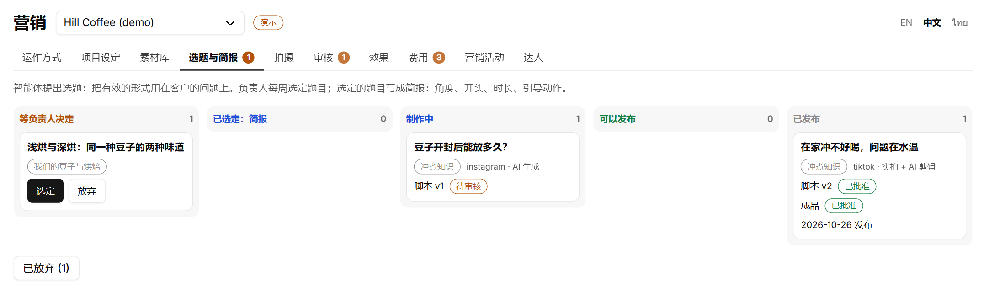
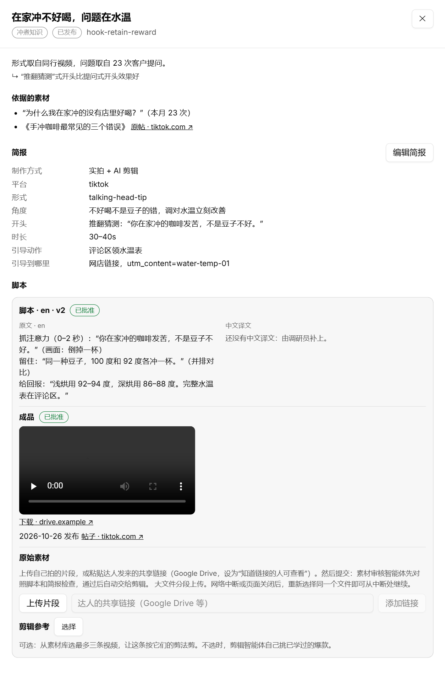

# 选题与简报

## 学习目标

学完本章，应能：

- 使用选题看板了解每个选题的进度；
- 按一致的标准选定或放弃选题；
- 阅读、修改并确认简报。

## 选题看板

“选题与简报”页以看板显示全部选题，每一列是一个阶段。

| 列 | 含义 | 下一步由谁推动 |
|---|---|---|
| 等负责人决定 | 智能体提出、尚未决定的选题 | 负责人选定或放弃 |
| 已选定：简报 | 已选定，简报撰写中或待确认 | 内容制作智能体撰写；负责人确认 |
| 制作中 | 脚本、素材或成品正在进行 | 智能体、专员、审核人 |
| 可以发布 | 成品已批准 | 专员发布 |
| 已发布 | 已记录帖子链接 | 进入效果统计 |

看板下方可以展开已放弃的选题。

每张卡片显示选题所属的内容主题、平台和制作方式，以及脚本和成品的审核状态。

## 选定或放弃

内容制作智能体每周提出选题，每个选题注明所属内容主题、依据的素材和要验证的假设。负责人每周决定一次。

判断时依次考虑：

1. **是否对应客户的问题。** 查看“依据的素材”中是否有客户原话。
2. **是否符合内容主题的占比。** 本周某一主题已经足够时，同主题的选题可以留到下周。
3. **是否做得出来。** 需要实拍的选题数量不能超过团队每周可拍的条数。
4. **是否触及规则。** 需要使用禁用说法才能成立的选题应当放弃。

点击**选定**后，内容制作智能体立即开始撰写简报。点击**放弃**后，选题移入已放弃。

## 简报

简报在动笔或开拍之前确定一条内容的要点。点击卡片打开选题详情。

| 简报项 | 含义 |
|---|---|
| 制作方式 | AI 生成；实拍 + AI 剪辑；达人制作；外包或团队 |
| 平台 | 发布到哪个账号 |
| 形式 | 例如口播技巧、轮播图、短视频 |
| 角度 | 这条内容的核心说法 |
| 开头 | 前几秒说什么、展示什么 |
| 时长 | 成品的长度范围 |
| 引导动作 | 结尾要求观众做的一件事 |
| 引导到哪里 | 引导动作指向的位置及其追踪方式 |
| 营销活动 | 所属的活动；日常内容不填 |

### 确认简报

智能体撰写的简报是草稿。负责人阅读后可以**编辑简报**，然后点击**确认简报**。确认后，内容制作智能体立即开始撰写脚本。未确认的简报不会写成脚本。

负责人自己撰写的简报无需确认，保存后即开始撰写脚本。

确认前建议检查：

- 开头是否在第一句就点明内容与观众的关系；
- 引导动作是否只有一个；
- 制作方式是否现实：选择“实拍 + AI 剪辑”时，本周是否还有拍摄名额。

## 拍摄名额

制作方式为“实拍 + AI 剪辑”的简报受项目设定中“每周可拍条数”的限制：最近七天内此类简报达到该数量后，系统拒绝新的实拍简报，并提示改用其他制作方式或等待。

计划[集中拍摄](./shoots.md)时，需要在一周内为多条脚本撰写简报。此时应先把“每周可拍条数”调整为该周实际要拍的条数。

## 练习

1. 在演示项目中，对“等负责人决定”列中的选题按上述四项标准作出判断，并写下理由。只作书面判断，不要点击按钮。
2. 打开一个已有简报的选题，找出它的角度、开头和引导动作。
3. 判断该简报的引导动作与“引导到哪里”是否一致。

## 本章要点

- 负责人每周选题，标准是客户问题、主题占比、可行性和规则。
- 简报经确认后才会写成脚本。
- 实拍简报的数量受每周可拍条数限制。
