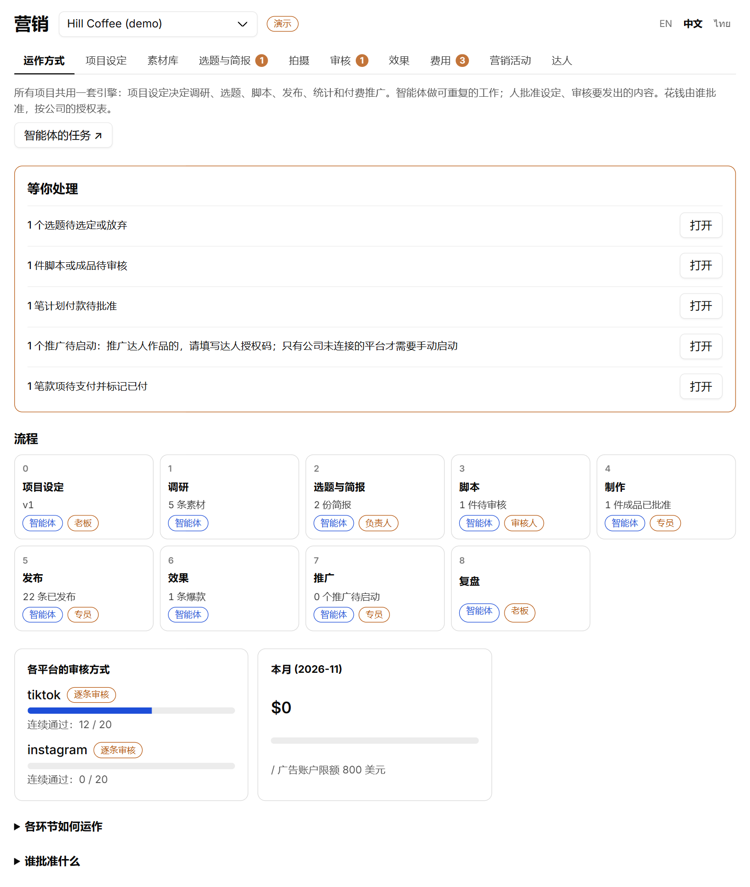

# 营销工作的整体流程

## 学习目标

学完本章，应能说明：

- 一条内容经过哪九个环节；
- 每个环节由智能体做什么、由人决定什么；
- 四个角色各自的职责。

## 九个环节

所有项目使用同一套流程。项目之间的差别只在[项目设定](./settings.md)。

| 序号 | 环节 | 智能体的工作 | 人的决定 |
|---|---|---|---|
| 0 | 项目设定 | 可以起草修改建议 | 老板批准每一个版本 |
| 1 | 调研 | 搜集并分析同行内容和客户原话，放入素材库 | 无；可以随时补充素材 |
| 2 | 选题与简报 | 提出选题；为选定的题目撰写简报 | 负责人选定或放弃题目，确认简报 |
| 3 | 脚本 | 按说话风格撰写脚本 | 审核人批准或退回 |
| 4 | 制作 | 生成图文；检查原始素材；剪辑视频 | 专员或达人拍摄；审核人批准成品 |
| 5 | 发布 | 无平台接口时不参与 | 专员发布，并记录帖子链接和追踪码 |
| 6 | 效果 | 在固定时间点统计数字，判定爆款 | 专员补充平台后台才能看到的数字 |
| 7 | 推广 | 为爆款申请推广预算，在广告账户中启动并每天检查 | 按公司授权表批准花钱 |
| 8 | 复盘 | 把自己的内容连同数字放回素材库，提出修改“假设”的建议 | 老板批准对设定的修改 |

流程是循环的：复盘的结论进入素材库和项目设定，影响下一周的调研和选题。

## 人与智能体的分工原则

1. **智能体不作最终决定。** 设定、选题、要发出的内容、合同和付款，都由人批准。
2. **智能体不持有平台密码。** 没有接口的平台由专员手动发布。系统不使用虚假账号，不在平台禁止时抓取数据，也不替任何人登录账号。
3. **智能体只依据项目设定工作。** 设定中没有写明的内容，智能体不得自行猜测。设定写得越具体，产出越接近预期。
4. **花钱按公司的授权表批准。** 营销系统只记录推广和付款，不决定由谁批准。

## 四个角色

| 角色 | 职责 | 主要使用的页面 |
|---|---|---|
| 老板 | 批准项目设定的每个版本；决定禁用说法和广告账户限额 | 项目设定 |
| 负责人 | 每周选题；确认简报；决定达人签约；可在素材审核未通过时决定直接剪辑 | 选题与简报、达人、营销活动 |
| 审核人 | 对照设定审核脚本和成品；审核达人发布前的视频 | 审核 |
| 专员 | 拍摄和上传素材；发布；记录数字、生意和付款；向达人索取授权码 | 拍摄、效果、费用 |

发布内容使用外语时，还可以为每种语言指定一名**语言检查人**。该语言的脚本先由检查人确认用语，再交审核人。

## 审核方式会随表现放宽

新平台的每一份脚本和成品都要经过审核人。某个平台连续 20 件一次通过后，系统改为抽查：每五件送审一件，其余自动通过并留有记录。只要有一件被退回，该平台恢复逐件审核。

“运作方式”页的“各平台的审核方式”显示每个平台当前的方式和连续通过的件数。

## 练习

1. 进入演示项目，打开“运作方式”页，找出目前各环节的数量：素材、简报、待审核、已发布、爆款各有多少。
2. 展开页面下方的“谁批准什么”，对照本章的角色表，确认自己的角色需要批准哪些事项。

## 本章要点

- 流程固定为九个环节，项目之间只有设定不同。
- 智能体承担可重复的工作，人负责批准。
- 审核从逐件开始，表现稳定后改为抽查。
