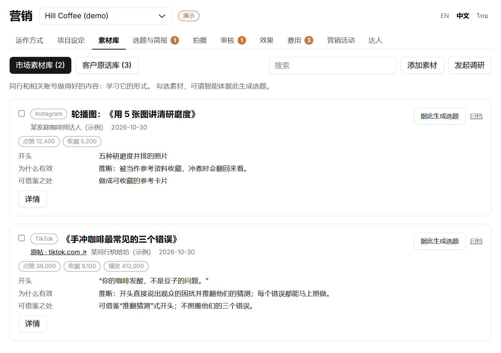
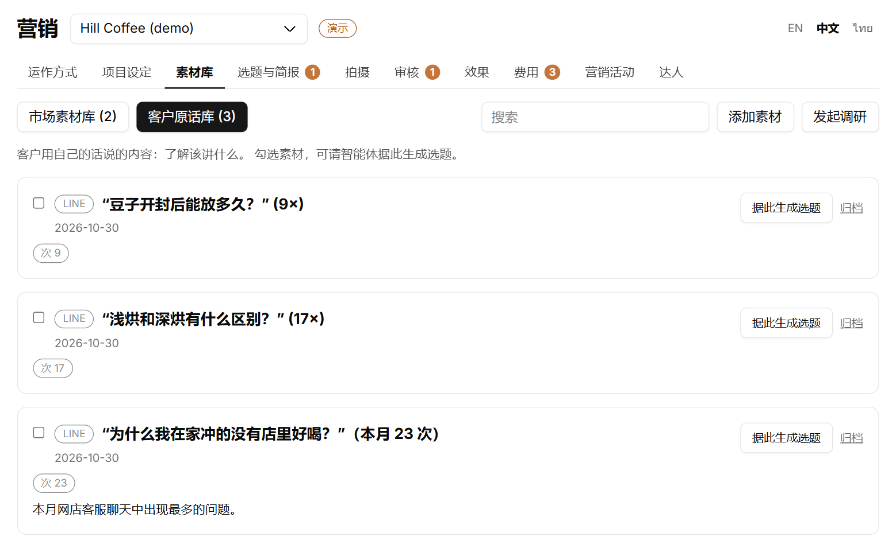

# 调研与素材库

## 学习目标

学完本章，应能：

- 区分两个素材库的用途；
- 向素材库添加素材，并发起一次调研；
- 读懂一条素材的分析，并据此请智能体生成选题。

## 两个素材库

| 素材库 | 收录内容 | 用途 |
|---|---|---|
| 市场素材库 | 同行和相关账号做得好的内容 | 学习形式：开头、结构、节奏、时长 |
| 客户原话库 | 客户用自己的话说的内容：聊天、评论、评价中的提问和抱怨 | 了解该讲什么：话题、顾虑、用词 |

选题的基本方法是把市场素材库中有效的形式，用在客户原话库中的问题上。

## 素材的分析

调研员（智能体）为每条素材填写同一组分析项，因此素材之间可以比较：

| 分析项 | 含义 |
|---|---|
| 开头 | 前几秒说了什么或展示了什么 |
| 开头类型 | 例如提问、推翻猜测、展示结果 |
| 形式、时长、节奏、结构 | 内容的组织方式 |
| 角度 | 从哪个方面切入话题 |
| 情绪 | 希望观众产生的感受 |
| 客户痛点 | 对应客户的哪项困扰 |
| 引导动作 | 结尾要求观众做什么 |
| 可信依据 | 用什么让人相信：数字、实拍、证言 |
| 为什么有效 | 调研员的推断，以“推断：”开头 |
| 可借鉴之处 | 可以用于本项目的具体做法 |

阅读分析时注意区分事实和推断。数字和内容描述是事实；“为什么有效”是推断，供参考。

市场素材还显示**高于常规（倍）**：该条内容的播放量相对作者平时水平的倍数。倍数高说明这条内容本身有效，而不仅仅因为账号粉丝多。

外语素材保留原文，并附中文译文。没有译文的素材由调研员补上。

## 添加素材

团队成员看到值得参考的内容或客户的原话，可以随时添加：

1. 打开“素材库”，选择素材库，点击**添加素材**。
2. 填写平台、账号、标题和链接。
   - 市场素材：标题用几个字说明内容；备注中写文案或脚本，以及你认为它有效的原因。
   - 客户原话：标题写客户问了什么；正文写客户的原话。
3. 可以附上截图、视频等文件。
4. 保存。添加到市场素材库的内容会由调研员分析，分析完成前显示“分析中”。

## 发起调研

调研员每周按项目设定中的调研计划搜索一次。需要立即调研时：

1. 在“素材库”页点击**发起调研**。
2. 勾选调研计划中的条目。
3. 可以在“重点”中补充话题、关键词或需要关注的竞争对手。
4. 点击**发给调研员**。

调研员只保留表现明显超出作者常态的内容。调研进行期间页面显示“调研进行中”及任务链接。

## 据素材生成选题

1. 在市场素材库或客户原话库中勾选素材，或点击某条素材的**据此生成选题**。
2. 填写选题数量，必要时写给智能体的说明，例如“只做 Instagram”。
3. 点击**发给内容制作智能体**。

选题送达之前，“选题与简报”页显示一张“生成中”的卡片。

## 归档

不再有参考价值的素材可以**归档**。归档的素材不再用于选题，但不会被删除。

## 练习

1. 在演示项目的市场素材库中，找出“高于常规”或数字最突出的一条，读它的“可借鉴之处”。
2. 在客户原话库中找出出现次数最多的问题。
3. （练习项目）向客户原话库添加一条你在工作中实际听到的客户提问。

## 本章要点

- 市场素材库提供形式，客户原话库提供话题。
- 分析中的“为什么有效”是推断。
- 任何成员都可以添加素材，并可以随时发起调研。
