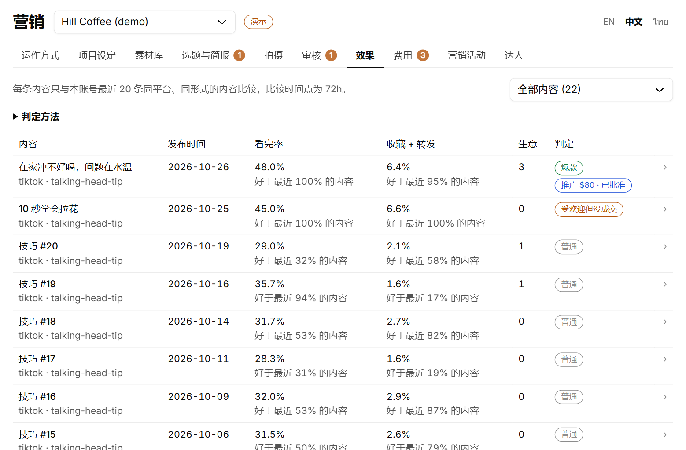
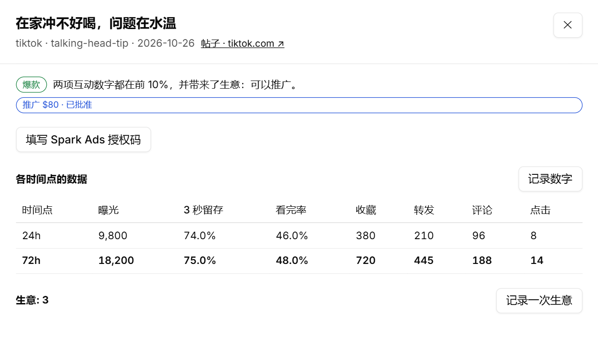

# 效果与爆款判定

## 学习目标

学完本章，应能：

- 说明内容在哪些时间点统计、与什么比较；
- 解释四种判定结果及各自的后续处理；
- 补充系统无法自动取得的数字。

## 效果页

每一行是一条已发布的内容。页面上方可以在“全部内容”和“只看爆款和待处理的内容”之间切换，**判定方法**说明当前项目的爆款规则。

## 在固定时间点统计

每条内容在发布后的固定时间点记录数字：1 小时、24 小时、72 小时、7 天、28 天。只有在同一时间点的数字才互相比较，因此发布三天的内容不会与发布三周的内容比较总播放量。

数字分为三层：

| 层次 | 数字 | 说明 |
|---|---|---|
| 注意 | 曝光、3 秒留存 | 有多少人看到，开头是否留住人 |
| 互动 | 看完率、收藏、转发、评论 | 内容本身是否有价值 |
| 生意 | 点击、咨询、注册、订单 | 是否带来业务结果 |

## 只与本账号比较

每条内容只与本账号最近 20 条同平台、同形式的内容比较。页面显示“好于最近 N% 的内容”。不同账号、不同平台之间不作比较，因为粉丝数量和平台机制不同。

达人账号上的视频只与同平台、同形式的其他达人视频比较，不与自有账号比较。

## 四种判定

默认规则是：在 72 小时这个时间点，看完率和“收藏 + 转发”两项都排在本账号的前 10%，并且至少带来一次生意。项目可以在设定的“爆款规则”中调整这三个数值。

| 判定 | 条件 | 后续处理 |
|---|---|---|
| 爆款 | 两项互动数字都在前列，并带来了生意 | 可以申请[推广](./boosts.md) |
| 受欢迎但没成交 | 互动在前列，但没有带来生意 | 更换引导动作，而不是花钱推广 |
| 普通 | 不在前列 | 进入素材库，供复盘 |
| 还没有数据 / 可比较的内容太少 | 尚未到判定时间点，或同类内容不足 | 等待 |

### 新账号

判定需要至少 5 条更早的同平台、同形式内容，并且有该时间点的数字。新账号在达到这个数量之前，任何内容都不会被判为爆款，也不能推广。这段时间的任务是按计划稳定发布，积累可比较的内容。

## 查看一条内容

点击一行打开详情。

详情显示判定及其理由、各时间点的数字、带来的生意，以及该内容的推广。

## 补充数字

分析员（智能体）读取公开可见的数字。看完率、3 秒留存等只在平台后台显示的数字，需要专员补充。缺少数字时，专员收到任务，“等你处理”中显示“若干内容缺少数据”。

1. 在平台后台查看该内容在对应时间点的数字。
2. 打开“效果”页，点击该内容，点击**记录数字**。
3. 选择时间点，填写曝光、3 秒留存、看完率、收藏、转发、评论和点击。
4. 保存。点击已有的数字可以更正。

数字应当在时间点前后及时记录。延迟过久，后台显示的已是更晚的累计值。

## 复盘

每周，分析员把自己的内容连同数字放回市场素材库，并用与外部素材相同的分析项分析。由此可以直接比较“我们做的”和“别人做的”。

分析员还会对照项目设定中的“待验证的假设”，提出修改建议，例如“推翻猜测式的开头比提问式的开头看完率更高”。建议以新的设定草稿提交，由老板批准。

## 练习

1. 在演示项目的“效果”页找出被判为爆款的内容，打开详情，说明它满足了哪些条件。
2. 找出一条“受欢迎但没成交”的内容，提出一个不同的引导动作。
3. 打开任意一条内容的**记录数字**表单，说明每一栏在平台后台的什么位置可以查到，然后关闭，不要保存。

## 本章要点

- 数字在固定时间点记录，只与本账号的同类内容比较。
- 爆款必须同时满足互动和生意两个条件。
- 新账号需要先积累至少 5 条可比较的内容。
