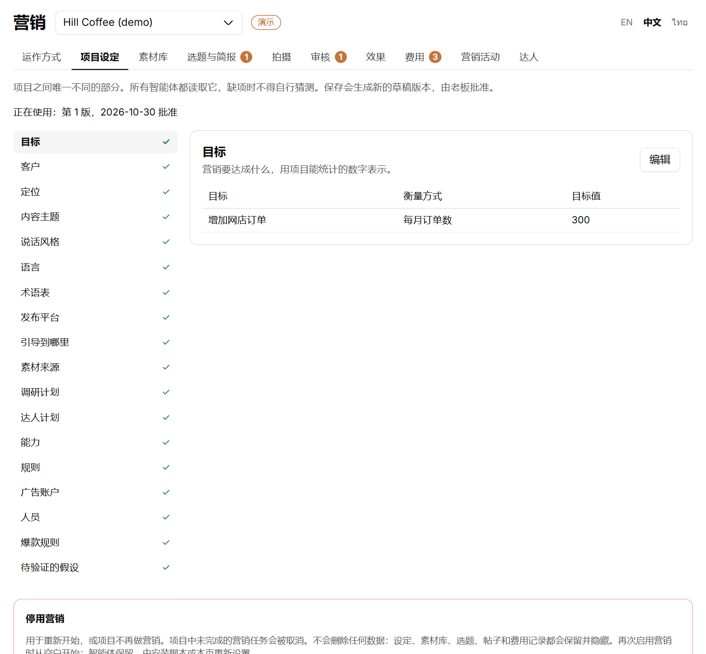
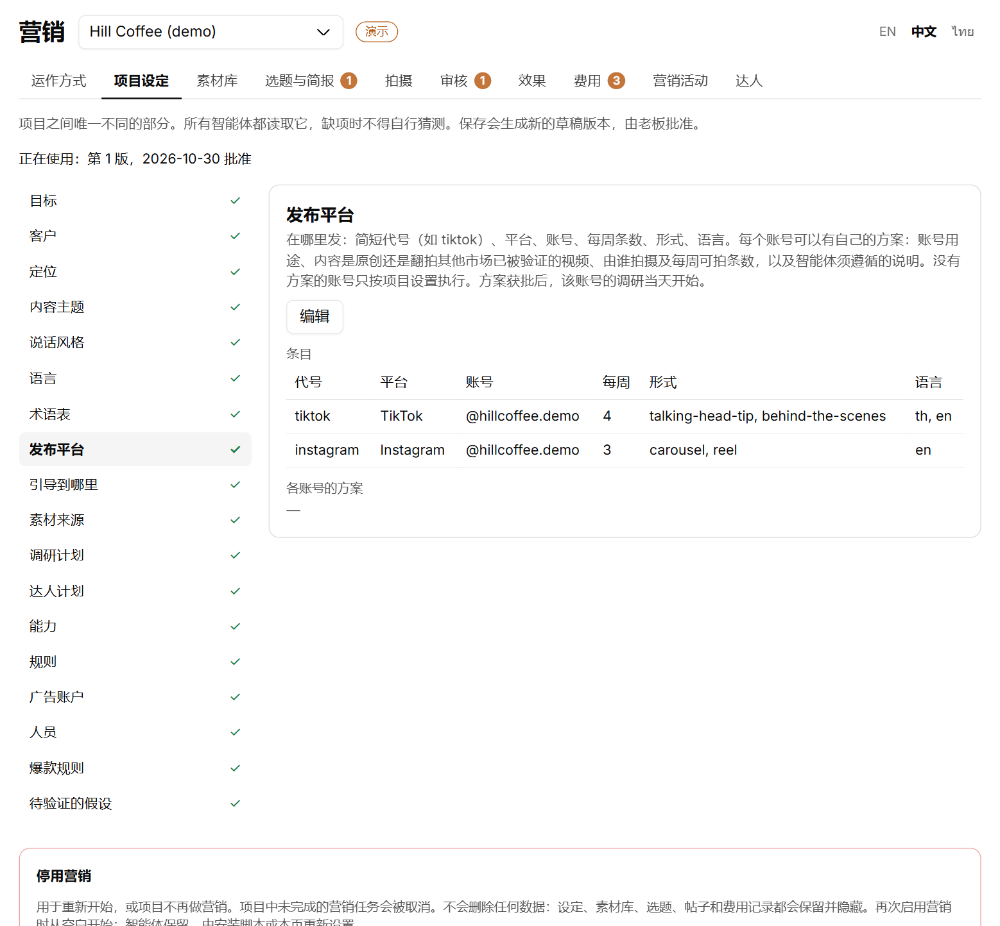
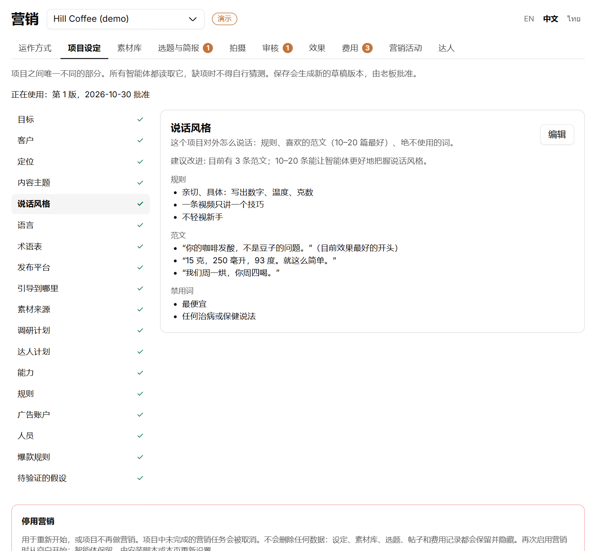
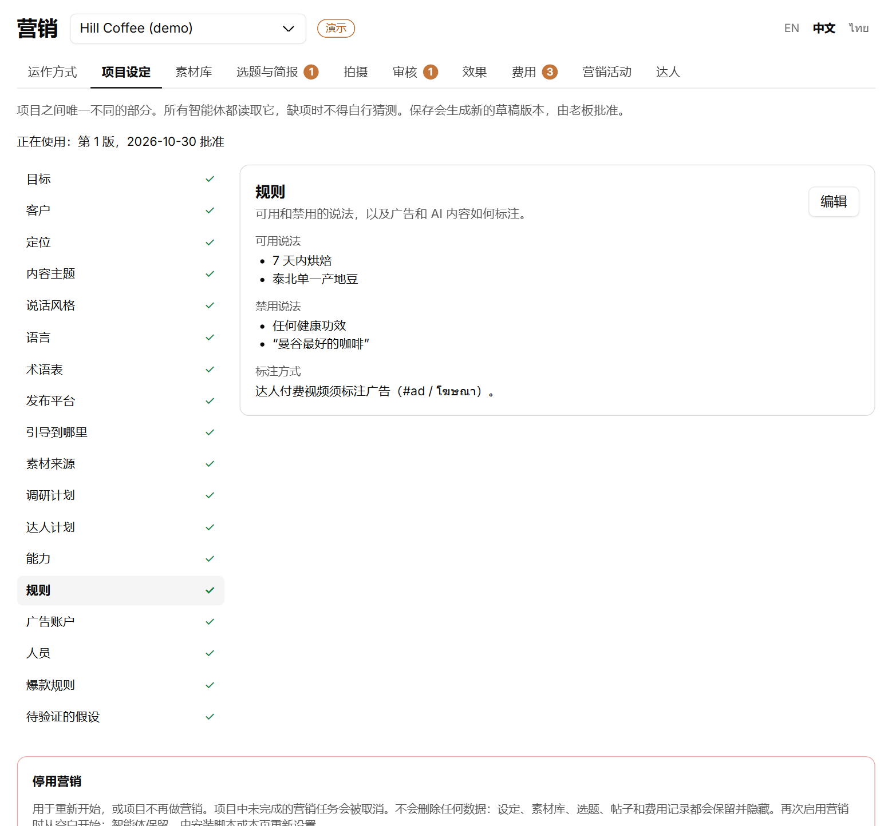

# 项目设定

## 学习目标

学完本章，应能：

- 说明项目设定各部分的含义及其对智能体的影响；
- 修改设定并提交批准；
- 判断一项设定是否写得足够具体。

## 设定的作用

项目设定是项目之间唯一不同的部分。所有智能体在开始任何工作之前都先读取它，并且只依据它工作：缺少的内容不得自行猜测。项目没有已批准的设定时，系统不会运行。

因此，产出不符合预期时，首先检查设定是否写明了相关要求，其次才是退回具体的内容。

## 各部分的含义

| 部分 | 填写内容 | 对工作的影响 |
|---|---|---|
| 目标 | 营销要达成的结果，以项目能统计的数字表示 | 选题和复盘以此为准 |
| 客户 | 内容给谁看，他们的困扰，他们在哪里，使用什么语言 | 决定讲什么、用什么语言 |
| 定位 | 客户不用我们时用什么，只有我们能提供什么，对客户的价值 | 决定内容的角度 |
| 内容主题 | 反复讲的 3–5 个话题及各自占比，合计 100% | 每周选题按占比分配 |
| 说话风格 | 规则、范文（10–20 篇为宜）、禁用词 | 脚本的语气和用词 |
| 语言 | 发布内容使用的每种语言及其检查人 | 该语言的脚本先经检查人 |
| 术语表 | 品牌、产品、优惠等必须一致的用语及其外语写法 | 撰写和检查时遵守 |
| 发布平台 | 账号代号、平台、账号、每周条数、形式、语言；每个账号可以有自己的方案 | 决定在哪里发、发多少 |
| 引导到哪里 | 从内容到成交的路径，如何追踪，什么算一次生意 | 引导动作和追踪码 |
| 素材来源 | 客户原话的来源，关注的账号和关键词 | 调研的范围 |
| 调研计划 | 每行一个平台和国家，以及该市场语言的关键词 | 调研员每周搜索的内容 |
| 达人计划 | 每行一个平台和市场，领域关键词、粉丝范围、人数和条件 | 达人发掘智能体寻找的对象 |
| 能力 | 团队每周能拍摄的条数，外包预算 | 需要实拍的选题数量不超过此数 |
| 规则 | 可用说法、禁用说法，广告和 AI 内容的标注方式 | 脚本撰写和审核的依据 |
| 广告账户 | 广告账户中设定的限额 | 超出后平台拒绝推广 |
| 人员 | 负责人、审核人、专员 | 待办事项和任务分配给谁 |
| 爆款规则 | 互动排在前多少、至少几次生意、在哪个时间点判定 | 哪些内容可以申请推广 |
| 待验证的假设 | 项目认为有效但尚未证实的做法 | 复盘环节据此提出修改建议 |

## 发布平台与账号方案

每个账号有一个简短代号（如 `tiktok`），其他页面用它指代该账号。

账号可以有自己的方案，写明该账号的用途、内容是**原创**还是**翻拍**其他市场已被验证的视频、由谁拍摄、每周可拍条数，以及给智能体的说明。做法为翻拍的账号，调研计划中必须有一行指向它。方案获得批准后，该账号的调研当天开始。

## 说话风格与规则

这两部分直接决定脚本的质量和审核的工作量。

填写建议：

- **规则要可以检查。** “亲切”难以检查；“写出数字、温度、克数”“一条视频只讲一个技巧”可以检查。
- **范文比规则有效。** 提供 10–20 篇认可的范文，智能体更容易把握语气。
- **禁用说法写原话。** 例如“任何健康功效”“某城市最好的”。禁用说法出现在审核页右侧，审核人逐条对照。
- **可用说法是可以核实的事实。** 例如“7 天内烘焙”。脚本中的事实性表述应来自这里。

## 填写示例

下表以一个从中国为越南买家代采并集运的项目为例，说明几个部分如何写得具体。示例仅用于说明填写方法，不代表任何项目的正式设定。

| 部分 | 过于笼统的写法 | 具体的写法 |
|---|---|---|
| 目标 | 提高知名度 | 每月新注册买家 400 人；每月首次下单 120 笔 |
| 客户 | 越南的网购人群 | 胡志明市和河内的小店主，从中国进货，担心货期不准和找不到可靠的货运方；使用越南语 |
| 定位 | 服务好、价格低 | 买家不用我们时通过熟人代购；我们提供全程可查的物流节点和明确的赔付条款 |
| 内容主题 | 产品、促销 | 进货知识 40%；费用与时效说明 30%；买家实例 20%；团队与仓库 10% |
| 禁用说法 | 不夸大 | “最便宜”；“保证几天到”；点名比较其他货运方 |
| 什么算一次生意 | 有人咨询 | 使用追踪码注册；首次下单 |

## 修改设定

1. 打开“项目设定”，在左侧选择要修改的部分。
2. 点击**编辑**，修改后保存。保存会生成一个新的草稿版本，不影响正在使用的版本。
3. 左侧每个部分旁的标记表示是否完整。草稿有缺项时不能批准，页面会列出所缺的内容。
4. 草稿完整后，由老板点击**批准**。批准后新版本立即生效，旧版本保留在历史版本中。

智能体可以提出修改建议，但不能批准。对“规则”和“广告账户”的修改尤其需要老板本人确认。

## 停用营销

页面底部的**停用营销**用于项目不再做营销或需要重新开始的情况。停用会取消项目中未完成的营销任务，但不删除任何数据。再次启用时从空白开始。此操作只应由所有者执行。

## 练习

1. 在演示项目中逐一打开各部分，找出：内容主题有几个、各占多少；禁用说法有哪些；每周可拍几条。
2. 找一条你认为写得不够具体的规则，写出更具体的版本。
3. 为你负责的项目写出“定位”三项：替代选择、只有我们提供、对客户的价值。

## 本章要点

- 智能体只依据已批准的设定工作。
- 设定以版本保存，每次修改由老板批准。
- 规则和说法写得可以检查，审核才有依据。
