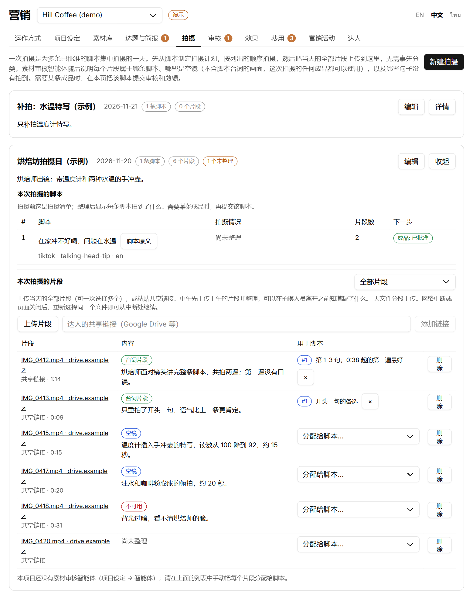

# 集中拍摄

## 学习目标

学完本章，应能：

- 从已批准的脚本制定一次拍摄的计划；
- 上传一天的全部片段并交给智能体整理；
- 根据整理结果安排补拍，并按需要逐条提交剪辑；
- 审阅并确认素材审核智能体为计划外拍到的内容提出的制作方案。

## 适用情况

团队经常集中拍摄：请一位拍摄人员工作一天，拍完十条以上的脚本，供之后两周发布。一天下来通常有几十到一百多个片段，文件名由相机生成，难以逐条对应到脚本。

“拍摄”页为这种情况设计：片段无需分类，一次上传；由素材审核智能体说明每个片段属于哪条脚本，以及哪些句子没有拍到。

拍摄也常常不完全按脚本进行：现场临时做了一段采访，老板在两条之间讲了一个故事，有时整次拍摄根本没有脚本。这些计划外的内容不会浪费：素材审核智能体会提出一份**制作方案**，说明可以从中做出哪些成品，由负责人确认，见下文[制作方案](#制作方案计划外拍到的内容)。

能写脚本时仍然建议先写脚本。有脚本的内容在拍摄前就经过了审核，拍完可以逐句对照；计划外的内容只能使用现场实际说出的话，说错的承诺或价格只能剪掉或重拍。

## 拍摄之前

1. 提前一周完成选题、简报和脚本，使脚本在拍摄日之前全部获得批准。为多条脚本撰写实拍简报之前，先把项目设定中的“每周可拍条数”调整为本次要拍的条数，见[选题与简报](./ideas.md)。
2. 打开“拍摄”页，点击**新建拍摄**。
3. 填写名称、拍摄日期和给团队的说明（由谁拍摄、地点、需要准备的物品）。
4. 在“要拍摄的脚本”中勾选脚本。编号按勾选的先后顺序排列：这是拍摄顺序，也是每个片段开头要报出的编号。没有脚本的拍摄可以一条都不勾选，直接保存。
5. 保存。

保存后，“本次拍摄的脚本”列表就是拍摄清单。点击**脚本原文**可以查看每条脚本的原文和中文。

## 拍摄当天

- 按清单顺序拍摄。每个片段开头说出脚本编号，例如“脚本三”。
- 每句拍两遍，说错时整句重来。
- 为脚本提到的每样东西拍几秒特写；另外拍一些不含台词的画面（环境、动作、细节），称为**空镜**，本次拍摄的任何成品都可以使用。
- 使用竖屏，1080p。

### 中午检查一次

中午把上午的片段上传并整理，可以在拍摄人员离开之前知道缺了什么。拍摄人员只工作一天时，这是成本最低的补拍机会。

## 上传片段

1. 在该次拍摄的“本次拍摄的片段”中点击**上传片段**，一次选择当天的全部文件；也可以粘贴共享链接。
2. 页面显示剩余文件数和每个文件的进度。上传期间保持页面打开。
3. 大文件分段上传，中断后重新选择同一文件即可继续，见[制作方式与原始素材](./production.md)。

片段不需要改名，也不需要分类。

## 整理素材

点击**整理 N 个新片段**。可以在旁边的说明栏写明需要素材审核智能体了解的情况。

素材审核智能体逐个处理片段：

| 片段类别 | 含义 |
|---|---|
| 台词片段 | 说了一条或多条脚本的台词。一个连续拍下三条脚本的长片段，会同时归入三条脚本 |
| 空镜 | 不含脚本台词的画面，本次拍摄的任何成品都可以使用 |
| 不可用 | 过暗、无声、失焦等；说明中写明原因 |
| 不属于任何脚本 | 可以使用，但不对应本次拍摄的脚本；能做成成品的，会出现在制作方案中 |

每个片段附有中文说明，写明拍了什么、哪几句、哪一遍最好。片段中说的话只转写一次并保存，之后的素材审核和剪辑直接使用，标有“已保存转写”。

之后上传的片段，再次点击整理即可，只处理新片段。**全部重新整理**用于需要重新检查每一个片段的情况。

## 整理结果

整理完成后，拍摄卡片上显示整理结果的摘要，例如“12 条脚本中 10 条已拍全”。脚本列表的“拍摄情况”一列显示每条脚本的结果：

| 结果 | 含义 | 处理 |
|---|---|---|
| 已拍全 | 每句都有可用的片段 | 可以提交 |
| 部分没有拍到 | 列出缺少的句子，原文附中文 | 补拍所缺的句子 |
| 没有拍到 | 没有可用的片段 | 补拍，或改期 |

有缺口时，专员收到一个补拍任务，列出每条脚本缺少的内容。补拍后把新片段上传到同一次拍摄，再次整理。

整理结果说明的是有没有拍到。每句是否与脚本一致、是否符合简报，由之后每条脚本的素材审核判断。

### 更正分配

智能体的分配有误时，可以在片段列表中更正：在“用于脚本”一列用**分配给脚本…**把片段加入某条脚本，或点击脚本编号旁的 × 取回。片段列表上方可以筛选“尚未整理”和“已整理但不属于任何脚本”的片段。

项目没有素材审核智能体时，以同样的方式手动分配每个片段。

## 制作方案：计划外拍到的内容

整理时，素材审核智能体把所有不属于任何脚本、但可以使用的片段放在一起看，提出可以做成的成品，随整理结果一起提交。这份清单就是**制作方案**。没有脚本的拍摄，整理结果就只有制作方案。

方案出现在这次拍摄的卡片中，卡片上标有“制作方案待确认：N 条”。负责人同时收到一个任务“确认制作方案：（拍摄名称）”，“运作方式”页的“等你处理”中也会列出待确认的成品数量，“拍摄”页签旁显示数字。

### 方案中的每一条成品

| 内容 | 说明 |
|---|---|
| 标题和理由 | 这条成品是什么，为什么值得做：它服务于账号方案或内容主题中的哪一项 |
| 平台、形式、时长 | 发到哪个账号；素材实际能做出的形式和长度 |
| 开头 | 前两秒：现场说过的一句话，或拍到的画面 |
| 引导动作 | 成品结尾要求观众做的事。现场通常没有人说，此时使用账号方案中的引导动作，并在“还缺”中说明如何加入 |
| 实际说的话 | 成品的台词：取自片段中实际说的话，原文附中文 |
| 使用的片段 | 每个片段用哪一段，附时间，例如“0:40–1:55，第二段回答” |
| 还缺 | 素材缺少的内容及补法：一张文字卡、一段旁白，或补拍一句 |
| 确认前请留意 | 需要负责人判断的事项，见下表 |

页面还会提示两条成品使用了同一个片段，以免两条成品重复同一段画面。

### 确认前请留意

| 提示 | 为什么要看 | 处理 |
|---|---|---|
| 现场说了承诺、数字、价格或时间 | 写好的脚本可以改字；现场说过的话只能剪掉或重拍 | 确认这句话准确；不准确时删去这句，或安排补拍 |
| 说了禁用说法，或不在可用说法中的表述 | 与项目规则冲突 | 删去这句，或不做这条 |
| 近距离拍到顾客、路人或儿童，没有记录表明对方同意 | 发布前需要对方同意 | 取得同意，或不做这条 |
| 与方案中另一条成品使用同一段画面 | 两条都发布会重复 | 只保留一条，或说明各用哪一段 |
| 画面中有其他品牌的标志，或背景中有音乐 | 可能无法发布或推广 | 确认剪辑能否避开 |

### 负责人如何确认

1. 打开“拍摄”页，展开这次拍摄，阅读“制作方案”中的每一条成品，点开片段链接查看实际画面。
2. 不做的成品，取消勾选。
3. 需要修改的成品，点击**编辑**。可以修改平台、内容主题、标题、形式、时长、角度、开头和引导动作。台词只能删除或调整顺序，不能加入片段里没有说过的话：剪辑只能剪出素材中存在的内容。
4. 点击**确认方案：制作 N 条**。全部都不做时，按钮为**确认：全部不制作**。

方案只确认一次。只有负责人或公司的所有者、管理员可以修改和确认。

### 确认之后

- 保留的每一条成品，自动成为一个选题、一份已确认的简报和一条已批准的脚本，归入这次拍摄，所用片段分配给它，并直接交给剪辑智能体。项目没有剪辑智能体时，脚本留在拍摄中等待。
- 这些脚本在脚本列表和选题详情中标有“按素材写成”。
- 负责人的确认同时代替简报的确认和脚本的审核：台词是现场说出的话，不是智能体写的。因此这些脚本不经过脚本审核，也不经过素材审核，不计入平台的审核抽查。剪出的成品仍然进入“审核”页，与其他成品一样由审核人批准。
- 按素材写成的简报不占用“每周可拍条数”。
- 未勾选的成品不会制作，它们的片段仍保留在这次拍摄中。

之后再上传片段并整理时，素材审核智能体会提交新的方案。新方案只替换尚未决定的成品；已经确认或放弃的成品保持不变。

### 在演示项目中查看

演示项目 Hill Coffee 有一次示例拍摄“烘焙坊拍摄日（示例）”，其中附有一份待确认的制作方案：三条成品，一条没有需要留意的事项，一条有两项，另有两条使用了同一个片段。可以先在这里阅读一份完整的方案。早先载入的演示项目中没有这次拍摄时，由所有者或管理员在“拍摄”页点击**载入示例拍摄**。

演示项目由全体成员共用，请不要在其中确认方案。

## 逐条提交

整理不会自动把任何脚本交给剪辑。在脚本列表的“下一步”一列，对需要成品的脚本点击**提交审核**（或**交给剪辑**）。之后的流程与单条脚本相同：素材审核通过后自动剪辑，成品进入“审核”页。

建议分批提交。例如先提交第一周要发布的七条，根据它们发布后的表现，再决定第二周几条的剪辑要求。

## 练习

1. （练习项目）在“拍摄”页点击**新建拍摄**，选择一条脚本，填写名称和日期后保存；打开脚本原文，确认它可以用作拍摄清单。
2. 为你的项目设计一次拍摄：列出要拍的脚本数量、需要的空镜，以及中午检查的时间。
3. 说明“已拍全”与“素材审核通过”的区别。
4. 阅读演示项目“烘焙坊拍摄日（示例）”的制作方案，对每一条成品书面写出：做还是不做，需要修改什么，理由是什么。不要点击确认。
5. 说明为什么按素材写成的脚本不能加入新的台词。

## 本章要点

- 先有批准的脚本，再安排拍摄。
- 片段无需分类，上传后由智能体整理，并报告缺少的句子。
- 中午整理一次，可以在拍摄人员离开之前补拍。
- 整理之后由人逐条提交审核和剪辑。
- 计划外拍到的内容由智能体提出制作方案，负责人确认一次；保留的成品直接交给剪辑，台词只能使用现场说过的话。
