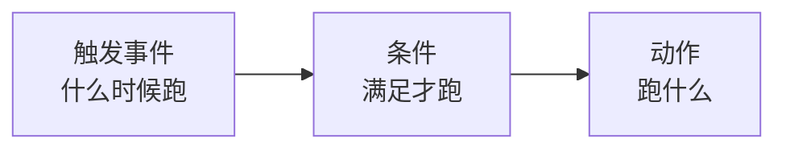

# 自动化规则

**设置 → 自动化** 让系统在某件事发生时自动做另一件事——最常见的用法是**把配送事件
推送到你自己的系统**。

## 一条规则的组成

### 触发

选什么事件触发这条规则。

### 条件

条件是可选的。不加条件时页面会明确写着"**无适用条件**——触发事件发生时将自动调用"。

加了条件的话，**所有条件都要满足**才执行。常用的筛法是：

- 按 **服务区域** —— 只有某几个片区的货才触发；
- 按 **事件类型** —— 只有某几种状态才触发。

### 动作

选 **动作类型**。一条规则可以配多个动作，按顺序编号。

最常用的动作是 **HTTP 回调（Webhook）**：事件发生时，系统把数据 POST 到你填的地址。

## 测试你的回调

编辑规则时可以**直接触发一次**看看对方收没收到。返回空响应体时页面会提示
"**响应体为空**"——这通常是正常的，说明对方收到了但没返回内容。

填的测试数据必须是 JSON 对象，否则提示"**负载必须是 JSON 对象**"。

## 启用和停用

规则可以随时**启用/停用**，切换后提示"自动化规则已启用/已停用"。不用的规则建议停用
而不是删除，改天还要用时不必重配。

<Staging source="tms#284">

## 运单付款后让仓库出库（Alpha WMS）

如果你在 **设置 → 集成** 里接了 **Alpha WMS**，可以让运单付清后由仓库自动安排出库，不用另写对接程序：

1. 在 **设置 → 集成 → Alpha WMS** 填好 **Base URL**、**API Key** 和 **API Secret**。**Default Warehouse ID** 可选，填了就作为默认出库仓库。
2. 在 **设置 → 自动化** 新建规则，触发选 **Waybill Paid**，动作选 **HTTP Webhook**。
3. **Webhook 地址** 填你的 TMS 地址加 `/api/integrations/alpha-wms/outbound`，**方式** 选 `POST`。
4. 要指定出库仓库，在 **请求正文模板（可选）** 里写 `{"warehouse_id": "<WMS 仓库 ID>"}`；留空就用 **Default Warehouse ID**。

规则触发时，系统把这张运单的全部包裹号发给 Alpha WMS，请它从指定仓库出库，并在请求里附上运单号，方便在仓库那边对应。

用 **立即触发** 测试时，响应里的 `wms_status` 和 `wms_response` 就是仓库的回复：

| 结果 | 含义 |
|---|---|
| 200 | 仓库已接受出库请求 |
| 502 | 仓库拒绝了请求，`wms_status` 和 `wms_response` 里是仓库返回的状态码和内容 |
| 500 | 没发出去：运单不存在、没配置 Alpha WMS 集成、运单没有包裹，或者既没在模板里写仓库也没填 **Default Warehouse ID** |

</Staging>

## 技术细节

回调的数据格式、重试行为、以及从代码那边怎么接，见
[开发者指南的 Webhook 章节](/tms/webhooks)。

:::note
Webhook 只能在这个界面上配置，**没有订阅接口**。这是设计如此。
:::
