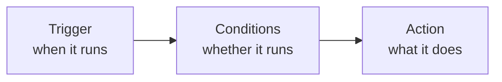

# Automation rules

**Settings → Automation** makes the system do something when something else happens. The
common use is **pushing delivery events into your own system**.

## What a rule is made of



### Trigger

The event that fires the rule.

### Conditions

Optional. With none, the page states plainly: "**No Condition is appliable** — this will
be called automatically when the trigger event occurs."

With conditions, **all of them must match**. The usual ones are:

- **Service Areas** — only goods in certain zones;
- **Event Types** — only certain statuses.

### Actions

Pick an **Action Type**. A rule can carry several actions, numbered in order.

The common one is an **HTTP webhook**: when the event fires, the system POSTs the data to
an address you supply.

<Staging source="tms#311">

## Consolidate waybills automatically by rule

A rule can put each received waybill that meets your conditions into a draft
[consolidated master](../waybills/consolidate), so you don't have to tick and consolidate
them by hand:

1. Under **Settings → Automation**, add a rule with the **Waybill Received** trigger and an
   **HTTP Webhook** action.
2. Set **Webhook URL** to your TMS address followed by `/api/waybills/auto-consolidate`, and
   **HTTP Method** to `POST`.
3. Put the consolidation parameters in **Request Body Template (Optional)**, for example:

```json
{
  "match_waybill_service_ids": ["<service ID>"],
  "match_waybill_subcontractor_id": "<subcontractor organization ID>",
  "match_route_id": "<route ID>",
  "consolidated_service_id": "<master's service ID>",
  "consolidated_route_id": "<master's route ID>"
}
```

| Parameter | Required | Meaning |
|---|---|---|
| `match_waybill_service_ids` | Yes | The waybill's service must be one of these |
| `match_waybill_subcontractor_id` | No | The waybill itself, or any of its leg sub-waybills, is [assigned to](../waybills/subcontract) this subcontractor. For example, when a waybill's last leg is handed to a courier, enter that courier |
| `match_route_id` | No | The waybill's route must be this one |
| `consolidated_service_id` | Yes | The master's service. It doesn't have to be in `match_waybill_service_ids`; the master is billed with this service's rate cards |
| `consolidated_route_id` | Yes | The master's route. The master's sender is the start station of the route's first leg, and its recipient the end station of the last leg |

Optional parameters you don't use can be left out or left empty (`""`). To find a service or
route ID, open its edit dialog under **Settings → Services** or **Settings → Routes**: it's
the value after `edit=` in the browser's address bar. For the subcontractor, enter the ID of
its organization, not the ID in the subcontractor's detail page address.

When the rule fires:

- If the waybill matches and there is a master made with the **same parameters** that is
  still a **Draft**, the waybill joins the newest one. The master gets one more package,
  holding all of the waybill's packages and weighing what the waybill weighs; its service,
  route, sender and recipient don't change.
- If there's no such draft master, a new one is created, with an `auto-consolidate:` tag and
  no sender account. So once a master leaves Draft, the next matching waybill starts a new
  master.
- If the waybill doesn't match, nothing happens.

When you test with **Fire Now**, `action` in the response is the outcome: `created` (a new
master), `appended` (added to an existing master) or `skipped` (not consolidated). With
`skipped`, `reason` says why:

| `reason` | Meaning |
|---|---|
| `service_mismatch` | The waybill's service isn't in `match_waybill_service_ids` |
| `route_mismatch` | The waybill's route isn't `match_route_id` |
| `subcontractor_mismatch` | Neither the waybill nor its leg sub-waybills are assigned to that subcontractor |
| `already_consolidated` | The waybill is already in a master |
| `leg_sub_waybill` | It's a leg sub-waybill; only whole waybills are consolidated |
| `consolidated_master` | It's a consolidated master itself |
| `no_packages` | The waybill has no packages |
| `waybill_canceled` | The waybill is canceled |

A missing or malformed parameter, a service or route that isn't your organization's, or a
route whose first leg has no start station or last leg no end station returns 400; an
unknown waybill returns 404.

</Staging>

## Testing your webhook

While editing a rule you can **fire it once** to see whether the other end receives it.
An empty response reports "**Empty response body**" — usually fine, meaning they received
it and returned nothing.

Test payloads must be JSON objects, or you get "**Payload must be a JSON object**".

## Enabling and disabling

Rules can be switched on and off at any time, confirmed with "Automation rule
enabled/disabled". Disable rules you aren't using rather than deleting them — you won't
have to rebuild them later.

## Technical detail

The payload format, retry behaviour and how to receive it in code are in the
[Developer Guide's webhook chapter](/tms/webhooks).

:::note
Webhooks are configured here and nowhere else — **there is no subscription API**. That's
by design.
:::
