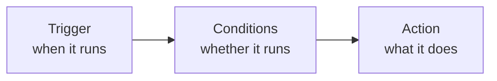

# Automation rules

**Settings → Automation** makes the system do something when something else happens. The
common use is **pushing delivery events into your own system**.

## What a rule is made of

### Trigger

The event that fires the rule.

### Conditions

Optional. With none, the page states plainly: "**No Condition is appliable** — this will
be called automatically when the trigger event occurs."

With conditions, **all of them must match**. The usual ones are:

- **Service Areas** — only goods in certain zones;
- **Event Types** — only certain statuses.

### Actions

Pick an **Action Type**. A rule can carry several actions, numbered in order.

The common one is an **HTTP webhook**: when the event fires, the system POSTs the data to
an address you supply.

## Testing your webhook

While editing a rule you can **fire it once** to see whether the other end receives it.
An empty response reports "**Empty response body**" — usually fine, meaning they received
it and returned nothing.

Test payloads must be JSON objects, or you get "**Payload must be a JSON object**".

## Enabling and disabling

Rules can be switched on and off at any time, confirmed with "Automation rule
enabled/disabled". Disable rules you aren't using rather than deleting them — you won't
have to rebuild them later.

## Ship from the warehouse once a waybill is paid (Alpha WMS)

If you've connected **Alpha WMS** under **Settings → Integrations**, a rule can ask the
warehouse to ship a waybill out as soon as it's paid, with no integration code of your own:

1. Under **Settings → Integrations → Alpha WMS**, fill in **Base URL**, **API Key** and
   **API Secret**. **Default Warehouse ID** is optional; when set, it's the warehouse to ship
   from by default.
2. Under **Settings → Automation**, add a rule with the **Waybill Paid** trigger and an
   **HTTP Webhook** action.
3. Set **Webhook URL** to your TMS address followed by
   `/api/integrations/alpha-wms/outbound`, and **Method** to `POST`.
4. To pick the warehouse, put `{"warehouse_id": "<WMS warehouse ID>"}` in **Request Body
   Template (Optional)**. Leave it empty to use the **Default Warehouse ID**.

When the rule fires, the system sends every package number of the waybill to Alpha WMS and
asks it to ship them from that warehouse, with the waybill number attached so the warehouse
can match them up.

When you test with **Fire Now**, `wms_status` and `wms_response` in the response are the
warehouse's reply:

| Result | Meaning |
|---|---|
| 200 | The warehouse accepted the outbound request |
| 502 | The warehouse refused it; `wms_status` and `wms_response` hold its status code and reply |
| 500 | Nothing was sent: the waybill doesn't exist, the Alpha WMS integration isn't set up, the waybill has no packages, or there's no warehouse in the template and no **Default Warehouse ID** |

## Technical detail

The payload format, retry behaviour and how to receive it in code are in the
[Developer Guide's webhook chapter](/tms/webhooks).

:::note
Webhooks are configured here and nowhere else — **there is no subscription API**. That's
by design.
:::
